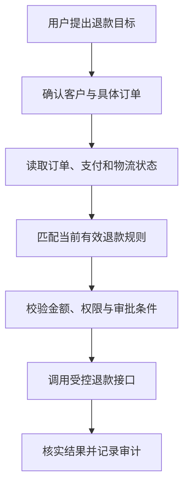

# 28. Agent 会读文档还不会办事？Ontology 如何连接业务执行

> **场景引入**：用户说“把下周那笔订单取消并退款”。知识库知道退款规则，却不知道“那笔”是哪张订单、是否已发货，也不知道用户能否执行。

> 对应原稿：[28-Agent 会读文档还不会办事？Ontology 如何连接业务执行](../origanl/28-Agent 会读文档还不会办事？Ontology 如何连接业务执行.md)。

---

## 🎯 一句话定位

**文档告诉系统规则，业务对象与实时数据告诉系统规则适用于谁，动作接口才真正办理业务。** Ontology（本体或业务语义层）可把客户、订单、支付等对象及关系组织起来，方便跨系统定位与理解；它本身不自动赋予退款权限，也不保证数据实时。

---

## 💎 核心要点概览

| 层 | 解决的问题 |
| --- | --- |
| 文档知识 | 有哪些规则和例外 |
| 业务语义 | 客户、订单、支付之间怎样关联 |
| 实时系统 | 当前对象真实状态是什么 |
| 权限动作 | 谁可执行，怎样确认与核验结果 |

---

## 🚀 核心总结

> **从“懂规则”到“办成事”，必须连接对象、实时状态、权限和执行反馈。**

---

## 一、“知道规则”为什么仍办不了退款

用户说：“把下周那笔订单取消并退款。”知识库可以找出退款政策，却不知道“那笔”是哪张订单、是否已发货、实付金额多少、当前用户有没有权限。要完成动作，还需定位客户和订单，读取实时状态，应用有效规则，最后由受控业务接口执行。

| 层 | 回答的问题 |
| --- | --- |
| 文档知识 | 退款规则是什么，何时生效？ |
| 业务语义层 | 客户、订单、支付、商品怎样关联？ |
| 实时业务系统 | 这张订单现在是什么状态、实付多少？ |
| 动作与权限系统 | 谁能发起退款，需不需要审批？ |

如果用户有多张下周订单，系统应先要求确认，而不是猜一张。若业务数据不同步，也不能因为本体里“订单关联支付”就认为支付状态准确。

## 二、Ontology 的实际作用与边界

可以把 Ontology 理解成企业业务对象地图：对象类型是“客户、订单、商品”，属性是“订单状态、实付金额”，关系是“客户拥有订单、订单对应支付”。在某些平台里，它还能连接动作类型。以 Palantir Foundry 的 [Ontology 与动作文档](https://www.palantir.com/docs/foundry/action-types/overview/index.html)为例，业务概念会映射到实际数据，动作另有参数和规则；[权限文档](https://www.palantir.com/docs/foundry/action-types/permissions)说明，能看到动作与能执行动作仍需分别授权。

这些是特定平台的设计示例，不代表所有企业都要引入同样的产品。小系统只要数据模型清楚、接口边界明确，也能完成上述任务。跨多个系统、对象关系复杂且术语不统一时，建设统一语义层的价值才更明显。

## 三、面试口述版

> 我会先分清文档规则、业务对象、实时状态和执行权限。RAG 或 Wiki 帮系统找到“规则是什么”；Ontology 或清晰的数据模型帮它定位“这是谁的哪笔订单、关联哪笔支付”；业务 API 提供当前状态并执行动作。退款前还要确认对象、核验规则版本、金额、权限与审批，执行后核实结果并留痕。Ontology 是组织业务语义的方法，不会自动解决授权和事务。

**自测：**只知道“7 天内可退款”，为什么不能直接执行？客户有两张相似订单时，系统缺少哪一步？

**一句话带走：从懂规则到会办事，中间还隔着对象、状态、权限与执行结果。**

---

## 四、落地 Checklist

- [ ] 能把用户提及的对象定位到唯一业务 ID。
- [ ] 实时状态从权威系统读取，不从文档或旧记忆猜测。
- [ ] 规则版本、适用条件和权限在执行前核对。
- [ ] 执行后查询真实结果并保留审计记录。

## 五、总结（一句话带走）

> **Ontology 帮系统理解业务关系，不能代替事务、授权和结果验证。**
