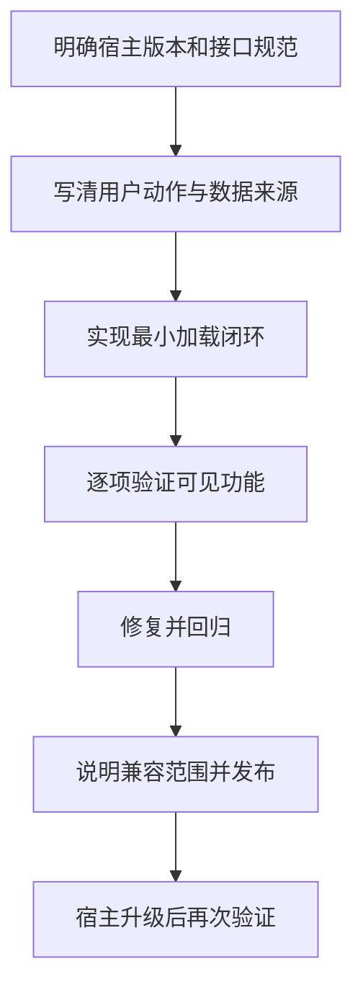

# 29. Harness 插件怎么开发？从接口对齐到验证维护

> **场景引入**：技能市场插件的页面显示“安装成功”，用户在新会话里却无法使用技能。页面状态与宿主真实加载状态不一致，才是要解决的问题。

> 对应原稿：[29-Harness 插件怎么开发？从接口对齐到验证维护](../origanl/29-Harness 插件怎么开发？从接口对齐到验证维护.md)。不同宿主平台的插件协议不同，具体实现应以目标平台当前版本文档为准。

---

## 🎯 一句话定位

**插件开发的第一步是对齐宿主接口，最后一步是验证真实加载与持续兼容。** 生成了代码、页面显示“安装成功”，都不能证明插件真的可用。

---

## 💎 核心要点概览

| 阶段 | 验收依据 |
| --- | --- |
| 接口对齐 | 宿主版本、入口、权限与安装来源明确 |
| 最小闭环 | 宿主能发现、加载并调用插件 |
| 功能验证 | 列表、搜索、安装和使用逐项成立 |
| 发布维护 | 升级后仍兼容，失败可定位 |

---

## 🚀 核心总结

> **插件的完成标准是宿主真实可用，不是生成了文件或显示了成功提示。**

---

## 一、用“技能市场插件”走一遍

需求是查看技能列表、搜索、打开详情、安装技能。开始写代码前，先确认宿主支持哪种安装来源、插件入口是什么、权限如何声明、安装文件存哪里、何时加载或卸载。只给开发者一张页面截图，这些关键行为都无法确定。

| 阶段 | 要得到的结果 |
| --- | --- |
| 需求与接口 | 业务动作、数据来源、宿主版本与官方示例 |
| 最小闭环 | 宿主能发现插件，列表与详情可见，测试技能可安装并加载 |
| 逐项验证 | 搜索确实过滤，分页确实追加，安装后会话能使用 |
| 发布维护 | 兼容版本、配置步骤、故障定位与升级验证 |

## 二、怎样判断“安装成功”是真的

至少确认三件事：插件文件到达正确位置；宿主的插件列表或日志显示它已加载；进入实际会话能触发一项最小功能。前端按钮显示成功，只是界面状态；后端或宿主可能仍然失败。

逐项测试时写明预期、实际、日志和复现步骤。例如“输入关键词 `meeting` 后，结果仍包含不相关条目”，就能定位搜索逻辑；“搜索不好用”很难修。

## 三、三类常见故障

- **自身逻辑错误：**按钮未关联真实操作、分页覆盖而非追加、安装状态没持久化。
- **插件冲突：**多个插件争用名称、路由或资源。
- **宿主版本变化：**接口、权限或加载生命周期发生变化。

修复时先判断是哪一类，不要所有问题都靠重装。发布包应包含启动说明、必要配置、依赖和兼容的宿主版本；本地热重载通过不等于新用户环境通过。

## 四、面试口述版

> 我会先拿到宿主当前版本的插件开发文档和官方示例，再把需求拆成可验证的动作。先实现“被发现、被加载、完成一次最小操作”的闭环，然后逐项测搜索、详情、安装与实际使用。发布时记录兼容版本和配置步骤；宿主升级后回归加载与权限链路。页面提示成功不能替代宿主真实状态。

**自测：**插件显示“安装成功”却在会话里不可用，你先检查哪几处？只有一张 UI 截图为什么不足以写完整插件？

**一句话带走：插件的交付标准是宿主真实可用，而不是代码文件已经生成。**

---

## 五、落地 Checklist

- [ ] 实现前核对目标宿主版本和官方插件接口。
- [ ] 安装后用宿主实际加载与调用验证结果。
- [ ] 权限申请、失败提示与卸载流程可测试。
- [ ] 宿主升级后能跑一组兼容性回归。

## 六、总结（一句话带走）

> **先让最小插件在真实宿主中跑通，再扩展页面和功能。**
