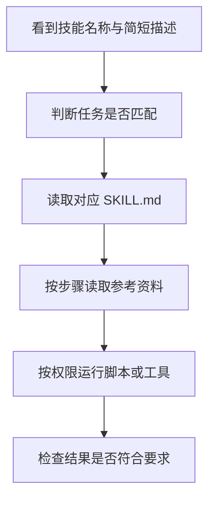

# 30. Skill 怎么复用？目录结构与渐进加载讲清楚

> **场景引入**：这次规划上海行程，下次规划北京行程。城市不同，但查开放时间、排路线、核算预算和验收结果的做法可以复用。

> 对应原稿：[30-Skill 怎么复用？目录结构与渐进加载讲清楚](../origanl/30-Skill 怎么复用？目录结构与渐进加载讲清楚.md)。

---

## 🎯 一句话定位

**Skill 保存的是同类任务中稳定的做法，不是某一次对话的完整记录。** 入口说明写触发条件与步骤，参考资料和脚本按需放在旁边；系统能否识别这些文件，取决于具体平台的规范。

---

## 💎 核心要点概览

| 内容 | 放在哪里 | 为什么 |
| --- | --- | --- |
| 稳定流程和触发条件 | Skill 入口 | 方便选择和复用 |
| 本次城市、日期和预算 | 当前任务输入 | 避免把个案写死 |
| 大量背景资料 | 按需引用的文件 | 减少无关上下文 |
| 确定性计算 | 可运行脚本或程序 | 便于复现和验证 |

---

## 🚀 核心总结

> **把稳定方法留下，把每次任务的可变参数放在输入里，按需加载必要资料。**

---

## 一、用旅游攻略作例子

这次去上海，下次去北京。城市、日期、同行人数是可变输入；“先查开放时间、再规划路线、最后核算预算并输出表格”是稳定流程。把稳定部分沉淀为 Skill，比每次复制整段旧对话更容易维护。

```text
travel-plan/
  SKILL.md          # 适用场景、步骤、限制、输出格式
  references/       # 可选：样例与说明
  scripts/          # 可选：预算核算脚本
```

文件夹名称和元数据写法应符合所用平台的要求；`references` 和 `scripts` 不是所有技能的必需项。脚本适合做确定性计算，模型适合解释需求和组织方案。脚本要实际运行，不能只在说明里写“请计算预算”。

## 二、渐进加载怎样工作



开始时只读简介，减少无关技能占用上下文；真正选中后，完整说明和必要资源仍要消耗读取与执行成本。加载不是免费，也不代表脚本一定有运行权限。

## 三、写好之后怎么验收

先把一类任务手动跑通，再把稳定步骤提炼成 Skill。新开一次对话，把“上海”换成“北京”测试：系统是否正确选择这个技能；读取了哪些资料；预算脚本是否真的运行；输出是否包含费用、路线和来源。再测一个不适用的请求，看它会不会误触发。

常见失败是把所有资料塞进主文档、描述太宽导致误选、把预算交给模型口算、只看到文件创建成功就宣布技能可用。解决办法是分清稳定规则与可变输入，保留最小入口，并用实际运行结果验证。

## 四、面试口述版

> 我会先找到一类重复且结果可检查的任务，把稳定的步骤、边界和输出格式放到 Skill 入口，把长参考资料和确定性脚本按需分开。运行时先用简短描述做路由，匹配后再加载完整说明和必要资源。做完要用不同输入和负例验证正确触发、工具执行与最终质量，不能只看目录已经建好。

**自测：**城市从上海换成北京时，哪些内容应留在 Skill，哪些应作为本次输入？预算脚本文件存在却没运行，算不算完成？

**一句话带走：复用的是稳定方法，是否有效要靠真实执行证明。**

---

## 五、实践 Checklist

- [ ] 入口说明明确适用与不适用场景。
- [ ] 稳定步骤与本次输入参数分开。
- [ ] 辅助资料只在需要时加载。
- [ ] 脚本真正运行，产出用正例和反例验收。

## 六、总结（一句话带走）

> **Skill 复用的是经验证的做法，不是复制上一次对话。**
