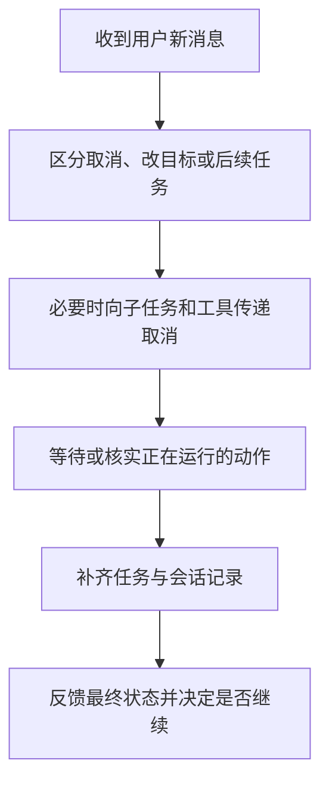

# 31. Agent 按了停止还在跑？任务取消的四个环节

> **场景引入**：用户点击停止，页面不再输出文字，后台测试进程却仍占端口，代码文件也可能继续变化。界面静止不等于任务停止。

> 对应原稿：[31-Agent 按了停止还在跑？任务取消的四个环节](../origanl/31-Agent 按了停止还在跑？任务取消的四个环节.md)。本篇侧重运行时取消信号、工具和会话收尾；任务状态与幂等的完整设计可参看第 01 篇。

---

## 🎯 一句话定位

**停止按钮要一路传到正在工作的模型、工具、子任务和进程，并对已发生的动作收尾。** 前端停止显示只改变了界面；后台是否停下，要看每一层是否接收并处理取消信号。

---

## 💎 核心要点概览

| 环节 | 要核查什么 |
| --- | --- |
| 信号传播 | 主任务、子任务、工具与子进程是否收到取消 |
| 执行停止 | 是否阻止后续步骤，正在运行的操作能否停 |
| 状态收尾 | 文件、端口、任务状态和外部副作用如何处理 |
| 用户反馈 | 停止请求与实际最终状态如何区分 |

---

## 🚀 核心总结

> **停止要传到执行层，再用真实状态证明已经停下。**

---

## 一、一个真实的“停不下来”场景

Agent 正在改代码并运行测试。用户点停止，网页不再显示新文字，但后台 `npm run dev` 派生的子进程还占着端口，文件也可能继续被修改。此时“界面已停止”和“任务已结束”是两个不同事实。

## 二、取消的四个环节

### 1. 取消信号：按任务传递

给主任务和子任务建立清楚的关联。取消主任务应通知其负责的子任务；单独取消一个子任务不应误伤其他任务。在 Go 中可通过 `context.Context` 逐层传递，但每个工具仍需支持或主动检查取消。检查点放在新一轮模型调用前、新工具调用前、重试等待时，以及工具返回后。

全局 `isStop` 布尔值无法区分多个并发任务，也不能自动打断阻塞调用。直接杀整个服务进程会丢掉其他任务与排障现场。

### 2. 工具与进程：分别设计停止方式

只读网络请求可尝试取消请求；外部写操作要核实是否已经发生。命令行工具可能启动子进程，停止外层 shell 后子进程仍运行；因此要按平台支持的进程组或等效机制管理，先尝试有序退出，超时后再处理残留进程。后台独立任务若继续运行，界面必须明确告知用户。

### 3. 会话记录：留下可恢复的事实

已经发起的工具调用不能悄悄消失。根据所用消息协议，为未完成调用记录“已取消”“结果未知”或实际返回结果，避免下次恢复时看到一段残缺历史就误以为工具成功。文件写到一半、外部 API 已提交等情况，要重新核实真实状态。

### 4. 新消息：区分纠错与后续任务

用户说“停下”是在取消；说“把预算改为 500 元再继续”是在修改当前目标；说“做完这个再写报告”是在排队下一项任务。系统应定义新消息何时生效：当前工具运行中通常先收拢结果，在安全边界再交给下一轮判断。

## 三、面试口述版

> 我会把停止设计成任务生命周期的一部分：每个任务有独立取消信号，并向子任务和可取消工具传递；命令进程还要管理子进程。取消后核实外部操作、补齐工具调用记录、保存部分完成状态，再向用户报告真实结果。同时区分用户是取消、修改当前目标，还是追加后续任务。仅断开前端流不是可靠的取消。

**自测：**为什么停掉一个 shell 进程后端口仍可能被占？用户说“先别发邮件，把收件人改成张三”，属于取消还是修改当前任务？

**一句话带走：真正的停止，要让执行层停得下、状态层说得清。**

---

## 四、运行时 Checklist

- [ ] 主任务取消会通知其子任务，且不会误伤其他任务。
- [ ] 派生进程退出后确认端口与资源已释放。
- [ ] 已完成的文件写入和外部动作有可核查记录。
- [ ] 用户看到的是“停止中”或最终状态，而非虚假的即时成功。

## 五、总结（一句话带走）

> **前端停流只是信号；执行、资源和状态都收尾，任务才算停。**
