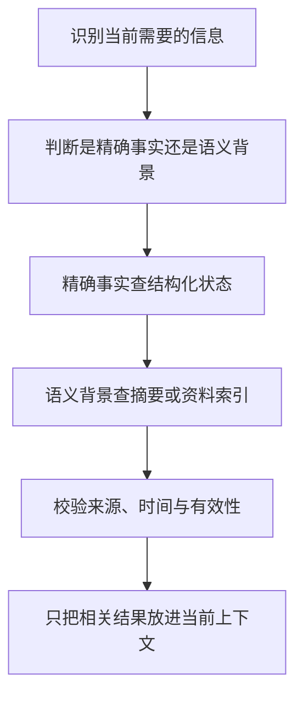

# 32. Agent 分层记忆：精确信息和语义检索如何分工？

> **场景引入**：用户去年住上海，今天明确说“搬到北京了”。向量库可能同时找回两句话，却不知道哪个地址当前有效。

> 对应原稿：[32-Agent 分层记忆：精确信息和语义检索如何分工？](../origanl/32-Agent 分层记忆：精确信息和语义检索如何分工？.md)。

---

## 🎯 一句话定位

**精确事实按键查，语义相关资料按意思找，近期对话按上下文读。** 把手机号、订单号、当前地址统统放进向量库，会让“相似”冒充“相同”，还容易把新旧事实混用。

---

## 💎 核心要点概览

| 信息类型 | 合适的读取方式 |
| --- | --- |
| 当前地址、订单号 | 带版本与来源的精确字段 |
| 近期任务状态 | 当前会话记录 |
| 旧讨论和相关材料 | 按需关键词或语义检索 |
| 付款与审批状态 | 权威业务系统实时查询 |

---

## 🚀 核心总结

> **先决定信息如何更新、谁说了算，再选文件、数据库或向量检索。**

---

## 一、用搬家例子理解新旧记忆

用户去年说“我住上海”，今天说“我搬到北京了”。如果只追加两条记忆，系统下次搜索“用户住哪里”可能同时拿到上海和北京。向量检索并不知道哪条是当前有效事实。应把当前常住地更新为北京，保留上海为历史记录，并记录变更时间与来源。若用户只是“下周去北京出差”，则不能改写常住地。

| 层 | 保存什么 | 读取方式 |
| --- | --- | --- |
| 会话元数据 | 会话 ID、入口、当前任务 | 精确键值与生命周期管理 |
| 用户结构化档案 | 当前地址、偏好、已确认身份信息 | 按用户与字段精确查询 |
| 近期摘要 | 讨论主题、已确认的决定 | 需要时加载摘要 |
| 当前窗口 | 本轮相关原始消息 | 按时间顺序直接读取 |

大量历史资料需要按含义搜索时，可以额外加语义检索，但它不能替代结构化档案的当前值。订单状态等权威业务事实还要以业务系统为准，不能凭聊天摘要办理退款。

## 二、为什么更新规则比存储形式更重要

每条长期事实应记录来源、时间、适用范围与状态。新信息到来时先判断：是补充、纠正、临时变化，还是永久更新。对于地址、电话等影响业务的字段，必要时向用户确认；旧信息可留作历史，但当前查询不应把它与新值平权展示。

摘要也会出错。摘要里写“用户可能搬家”不能被当作已确认事实，更不能自动覆盖结构化档案。信息冲突时，应追溯原始表达和权威来源。

## 三、面试口述版

> 我会按信息类型设计记忆层：会话 ID 和任务状态走精确存储，用户手机号、当前地址等关键字段走结构化档案，近期对话用摘要加必要原文，海量历史资料才考虑语义检索。事实更新要区分临时与永久，记录来源和有效期；旧地址转历史，新地址确认后生效。向量召回只负责找相关内容，不能决定精确业务字段的权威值。

**自测：**为什么不能靠向量相似度选订单号？“我去北京出差”和“我搬到北京”应怎样分别更新记忆？

**一句话带走：记忆系统先分清信息类型和更新规则，再选择检索技术。**

---

## 四、落地 Checklist

- [ ] 精确字段有来源、更新时间和当前/历史标记。
- [ ] 用户说“出差”不会被误写为“常住地变更”。
- [ ] 旧值不会因语义相似度高而覆盖新值。
- [ ] 订单、支付等事实从权威系统查询。

## 五、总结（一句话带走）

> **语义检索负责找相关，结构化状态负责确定当前值。**
