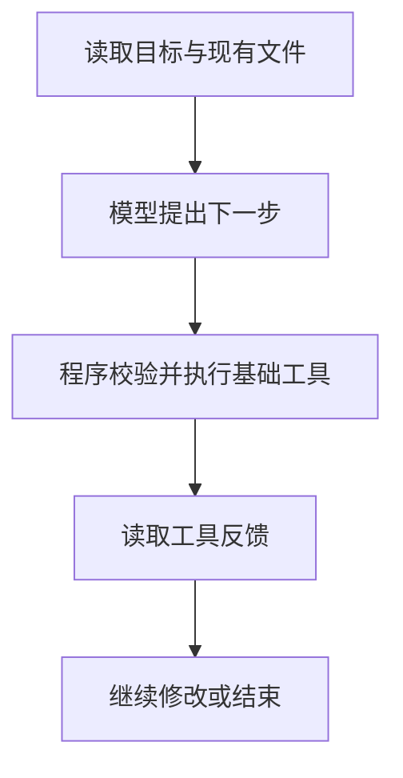

# 33. Pi 极简 Agent：工具少，为什么反而更好用？

> **场景引入**：一个编程 Agent 只有读、写、编辑、执行命令几类工具，却能完成“读代码 → 修改 → 测试 → 修复”。工具数量不是能力的唯一来源。

> 对应原稿：[33-Pi 极简 Agent：工具少，为什么反而更好用？](../origanl/33-Pi 极简 Agent：工具少，为什么反而更好用？.md)。这里以原稿介绍的 Pi 为案例讨论设计思路；具体工具与交互以 [Pi 官方站点](https://pi.dev/)的当前版本为准。

---

## 🎯 一句话定位

**内置工具少，能让 Agent 的基本行为更清楚；能力是否强，还要看工具能否组合、循环能否利用反馈、扩展是否受控。** 一把“执行命令”的工具可能完成很多事，也可能带来很大权限风险。

---

## 💎 核心要点概览

| 设计点 | 要回答的问题 |
| --- | --- |
| 工具集合 | 少数通用动作能否组合完成目标 |
| 反馈循环 | 测试失败后能否定位并修复 |
| 中途消息 | 新指令如何影响当前任务状态 |
| 权限边界 | 执行命令能触及哪些文件与系统 |

---

## 🚀 核心总结

> **工具少可以让决策更清晰，但强工具必须配合隔离、权限与验证。**

---

## 一、为什么少数基础动作仍能完成任务

原稿以读文件、写文件、编辑文件、执行命令为例。编程任务通常能组合这些动作完成：先读代码，再改文件，接着运行测试，最后根据测试结果修复。每类任务都单独加一个专属工具，反而可能让工具列表膨胀、选择变难。

工具数量只是入口设计。真正推动任务的是“提出动作—执行—观察—修正”的循环；没有反馈，四个工具也只是四个按钮。

## 二、运行中来了新消息怎么办

原稿区分两类消息：**steering** 修改当前任务，例如“你选错框架了，改用 Go”；**follow-up** 是当前任务完成后再做，例如“网站完成后再加后台”。前者应在安全边界影响下一轮决策，后者排队等待。Pi 的 [官方说明](https://pi.dev/)也介绍了运行中引导正在执行的任务。

会话可以保存或分支，但对话回到旧节点不等于代码文件也自动回到旧版本。文件恢复要靠版本管理或明确的文件快照，不能把聊天历史当作工作区状态。

## 三、扩展与安全边界

插件可以扩展工具或交互方式，Skill 可以保存任务流程与参考资料。按需加载有助于减少无关内容，但扩展越多，工具描述和权限边界也越难管理。

尤其要注意“执行命令”：它虽然只是一个工具，却可能读写大量文件、访问网络、启动进程。应按任务限制可访问目录、运行环境和危险操作确认。容器隔离是否有效，还取决于挂载和权限配置。

## 四、面试口述版

> 极简 Agent 的优势是内核行为清楚，少量通用工具通过循环组合完成复杂任务。但我不会只数工具数量；要看工具反馈能否回到模型、会话状态怎样交接、扩展是否按需加载。执行命令的能力很强，必须配合权限、隔离和确认。会话分支只能管理对话，代码文件仍要单独做版本控制。

**自测：**为什么四个工具仍能完成“读代码、修改、测试、修复”？聊天记录回退为什么不能保证代码回退？

**一句话带走：少工具让结构更清楚，边界与反馈决定系统是否可靠。**

---

## 五、落地 Checklist

- [ ] 每个工具有明确用途、参数和失败语义。
- [ ] 执行命令的权限与工作目录受限。
- [ ] 测试结果来自实际进程退出状态。
- [ ] 会话分支与代码文件版本控制分开管理。

## 六、总结（一句话带走）

> **极简工具集降低选择复杂度，可靠性仍靠反馈闭环与权限边界。**
