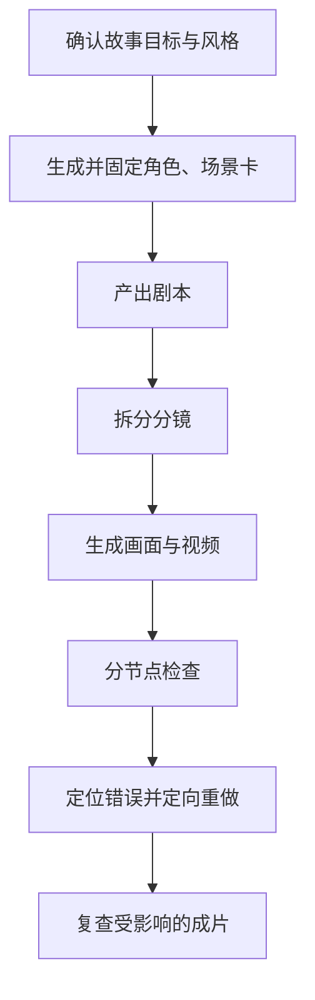

# 34. 全自动 AI 漫剧 Agent，接通接口后还缺哪些工程设计？

> **场景引入**：用户要求女主一直穿蓝色外套。剧本记住了，分镜却漏写，画面生成又未读取角色设定，成片里服装便不断变化。

> 对应原稿：[34-全自动AI漫剧Agent，接通接口后还缺哪些工程设计？](../origanl/34-全自动AI漫剧Agent，接通接口后还缺哪些工程设计？.md)。

---

## 🎯 一句话定位

**接通剧本、图片、视频接口，只说明能生成素材；能稳定交付作品，还需要统一需求、清晰的模块边界和定向修复能力。** 否则角色变了脸、分镜不连贯时，只能整条链路重跑。

---

## 💎 核心要点概览

| 环节 | 关键交付物 |
| --- | --- |
| 需求 | 角色、风格、剧情约束与版本 |
| 剧本/分镜 | 下游可读取的结构化镜头信息 |
| 素材生成 | 绑定角色资产与镜头版本的候选结果 |
| 验收修复 | 指出具体镜头和错误，定向重做 |

---

## 🚀 核心总结

> **接口连通证明“能生成”，跨环节约束一致和定向返工才证明“能交付”。**

---

## 一、从角色“变脸”看约束如何丢失

用户要求女主始终穿蓝色外套。剧本阶段记住了，分镜阶段只写“女主走进房间”，画面生成阶段又没读角色设定，成片里的衣服颜色开始跳变。单纯换个更强的图片模型也无法保证每个环节收到同一约束。

解决办法是维护一份**结构化需求**和角色卡：角色外貌、服饰、镜头风格、场景关系、禁止变化项、版本号。下游每个节点都读取同一版本。角色卡能降低漂移风险，最终画面仍要检查。

## 二、每个节点的输入和产出契约

| 节点 | 输入 | 产出 | 常见检查 |
| --- | --- | --- | --- |
| 剧本 | 需求、角色卡 | 分场景脚本 | 人物动机与情节是否自洽 |
| 分镜 | 剧本、风格、角色卡 | 镜头列表 | 每镜是否对应具体情节 |
| 画面 | 镜头、角色与场景卡 | 图片素材 | 人物、服装、场景是否一致 |
| 成片 | 图片、配音、时间轴 | 视频 | 音画、字幕、节奏是否匹配 |

检查器要指出**哪份产物、哪个位置、违反哪条要求**。例如“第 7 镜女主外套变红，与角色卡 v2 冲突”；然后只重做相关画面和受影响的后续合成，不必改整个剧本。

## 三、用户中途改需求怎么办

先更新结构化需求版本，再做影响分析：修改“女主外套颜色”影响角色卡、对应镜头和画面；修改故事结局可能影响剧本后半段、分镜和成片。不能只改某一步提示词，让其他节点继续沿用旧设定。对已审核的素材保存版本和引用关系，才能知道该重做哪部分。

## 四、面试口述版

> 我会把创作任务拆成需求、角色设定、剧本、分镜、画面和成片等节点，每个节点都有输入、输出和版本。用户要求先进入统一需求文档，角色与场景卡作为全链路约束。检查器按节点产出结构化问题报告，再根据依赖关系定向重做并复查受影响部分。接口连通只能证明能生成，质量闭环才能证明能交付。

**自测：**角色外套颜色变更后，哪些节点可能要重做？“视频不好看”为什么不足以驱动自动修复？

**一句话带走：生成能力负责产出素材，工程闭环负责稳定交付。**

---

## 五、落地 Checklist

- [ ] 角色设定与每个镜头绑定同一资产版本。
- [ ] 下游节点能读取上游约束，不靠口头记忆。
- [ ] 质检问题包含镜头位置、错误类型和修复范围。
- [ ] 用户改需求后只重做受影响的产物并复查连续性。

## 六、总结（一句话带走）

> **稳定的 AI 漫剧生产依赖资产、版本和验收链路。**
