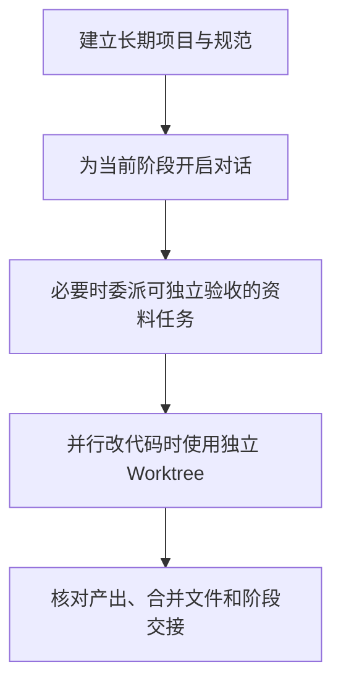

# 35. Agent 越用越乱？先理清项目、对话、子 Agent 和 Worktree 四层边界

> **场景引入**：同一项目开了多段对话，两段会话同时改同一个文件。分开聊天避免了上下文混乱，却仍可能互相覆盖代码。

> 对应原稿：[35-Agent越用越乱？先理清项目、对话、子Agent和Worktree四层边界](../origanl/35-Agent越用越乱？先理清项目、对话、子Agent和Worktree四层边界.md)。

---

## 🎯 一句话定位

**项目、对话、子 Agent 和 Worktree 解决的是四种不同的混乱。** 项目保存长期资产，对话承载当前阶段，子 Agent 隔离资料处理的上下文，Worktree 隔离并行修改的文件。用错层，换模型通常也解决不了问题。

| 层 | 主要作用 | 什么时候用 |
| --- | --- | --- |
| 项目 | 规则、环境和产物长期归档 | 一项工作要持续多次推进 |
| 对话 | 承载一个阶段的上下文 | 阶段清楚、任务目标相近 |
| 子 Agent | 独立处理可分割的信息任务 | 大量资料需单独阅读和归纳 |
| Worktree | 给并行代码修改独立目录 | 多条分支同时改同一仓库 |

---

## 💎 核心要点概览

| 层 | 主要隔离对象 |
| --- | --- |
| 项目 | 规则、环境和长期产物 |
| 对话 | 一个阶段的目标与上下文 |
| 子 Agent | 可拆分的信息处理任务 |
| Worktree | 并行代码修改的文件状态 |

---

## 🚀 核心总结

> **先判断混乱发生在信息、任务还是文件，再选相应的隔离机制。**

---

## 一、用办公室作比喻

项目像办公室，放长期使用的规范和设备；对话像桌上正在处理的一份文件，做完一个阶段就归档交接；子 Agent 像请同事去另一个房间调查资料，只把结论和证据带回来；Worktree 像两位同事各拿一份代码副本修改，之后再合并。

这些层不能互相替代。开两个对话却共用同一工作目录，仍可能互相覆盖文件；用了 Worktree 却不做阶段交接，仍会忘掉关键约束。

## 二、两个最容易混淆的边界

**对话压缩不等于任务状态保存。** 摘要可能丢失约束，所以阶段交接至少记录已完成事项、确认过的决定、未解决问题和下一步。对支付、审批等业务状态，还要查权威系统。

**Worktree 隔离不等于自动合并。** 两个目录可以安全并行修改，最后仍要审查差异、解决冲突并运行必要验证。串行任务通常无需为每次新对话都建 Worktree。

子 Agent 也不是免费加速：拆解、沟通、汇总和验收都有成本。任务边界清楚、结果可独立核查时才值得使用。

## 三、面试口述版

> 我会先看混乱发生在哪一层。长期规范找不到，就建项目沉淀；对话过长导致约束丢失，就做阶段交接；大量资料污染主上下文，才把独立分析交给子 Agent；并行代码修改互相覆盖，就用 Worktree 隔离文件。最后仍要核对交接内容、合并差异和验证结果，而不是指望某一层自动解决全部问题。

**自测：**两段对话同时改同一文件，分开对话足够吗？新开对话后，哪四类信息必须交接？

**一句话带走：先找到混乱所在的层，再用对应的隔离与交接机制。**

---

## 四、落地 Checklist

- [ ] 长期规则与产物归项目，不依赖单一会话记忆。
- [ ] 新对话交接当前目标、状态、关键证据和未完成项。
- [ ] 子任务有独立输入、输出与验收方式。
- [ ] 并行改代码时使用隔离工作树并核对合并差异。

## 五、总结（一句话带走）

> **对话隔离信息，Worktree 隔离文件；两者不能互相替代。**
