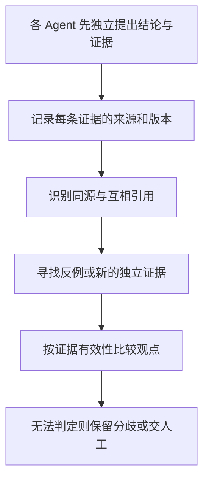

# 36. 多 Agent 辩论，为什么多数投票也会选错？

> **场景引入**：三位 Agent 判断能否退款。A、B 都引用同一份过期政策说“能”，C 引用当前政策说“不能”。2 比 1 的多数票仍可能错。

> 对应原稿：[36-多 Agent 辩论，为什么多数投票也会选错？](../origanl/36-多 Agent 辩论，为什么多数投票也会选错？.md)。原稿引用的研究结论未给出可核对的论文信息，本文不将其当作定量事实。

---

## 🎯 一句话定位

**多数票只有在意见具有足够独立性、证据可验证时才有参考价值。** 三个 Agent 如果都读了同一份错误资料，三个答案不会变成三份独立证据。辩论的目标是发现错误前提和新证据，而不是把“声音大”当成“事实对”。

---

## 💎 核心要点概览

| 检查点 | 为什么重要 |
| --- | --- |
| 来源独立性 | 转述同一资料不是多份证据 |
| 时效与适用范围 | 旧政策不能决定当前问题 |
| 新证据 | 讨论应推动核查，而非重复观点 |
| 无法裁决 | 保留分歧，转人工或补资料 |

---

## 🚀 核心总结

> **对事实问题先核证据，再看意见数量；重复引用不能增加可信度。**

---

## 一、一个 2 比 1 的错误结论

三个 Agent 判断某产品是否可退款。A、B 都引用了已过期的旧政策，认为可退；C 找到当前生效政策，认为不可退。简单投票得到 2 比 1，却把正确答案否决了。若 A、B 在辩论中互相引用对方，信心甚至会越来越高，但它们的证据仍只有同一个旧来源。

## 二、怎样改造辩论与裁决过程

第一轮应尽量独立作答，避免先看到多数意见就跟随。讨论阶段要求指出具体可检验的差异：“A 引用 v1，C 引用 v2；哪一版在订单日期生效？”新一轮如果没有新证据，只是重述观点，就没有继续辩论的价值。

**同源降权**是一种可考虑的设计，而不是固定公式。两位 Agent 用同一来源，也可能从不同条款发现不同线索；应记录证据依赖关系，避免把重复引用误当成独立支持。高风险决定最终仍需权威数据或人工复核。

## 三、怎样评估辩论是否有帮助

拿一组有标准答案和来源的案例比较：单 Agent、多 Agent 独立判断、互相辩论三种配置的正确率、错误自信度、成本与延迟。重点看错误是否被新证据纠正，而不是只数有多少次一致投票。

## 四、面试口述版

> 我不会直接让多个 Agent 自由辩论后多数投票。若它们共享错误检索结果，会产生相关性错误，票数没有独立信息量。我会要求初始结论独立产出、附来源与版本，检查证据是否同源，再让后续轮次寻找反例或新证据。结果按证据可靠性和适用性判断；无法判定时保留分歧并升级处理，并用固定案例评测辩论是否真的优于单 Agent。

**自测：**A、B 引用同一旧政策，C 引用新政策，为什么 2 比 1 不可信？哪种“新信息”能真正推动讨论？

**一句话带走：观点可以投票，证据不能靠重复引用增加票数。**

---

## 五、落地 Checklist

- [ ] 每个结论记录原始来源、版本和适用条件。
- [ ] 识别多个 Agent 是否引用同一个上游来源。
- [ ] 讨论围绕可核查的新证据，而非语气或人数。
- [ ] 无法裁决的高风险结论不会自动执行。

## 六、总结（一句话带走）

> **多数票可以汇总观点，事实仍要由证据与适用条件裁决。**
