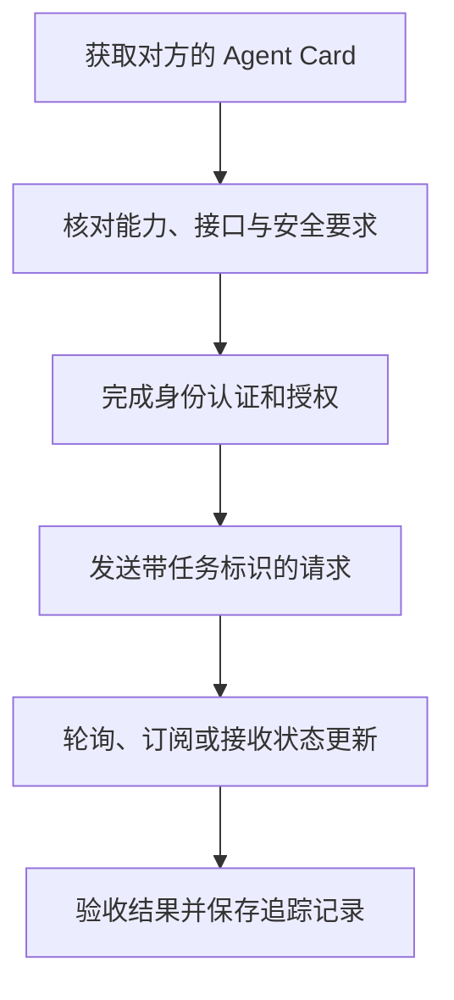

# 37. A2A 与 Agent Card：不同框架的 Agent 如何协作？

> **场景引入**：主 Agent 想把数据分析交给外部 Agent。仅拿到一个 HTTP 地址，不知道对方能做什么、接受什么格式，也不知道任务是否完成。

> 对应原稿：[37-A2A 与 Agent Card：不同框架的 Agent 如何协作？](../origanl/37-A2A 与 Agent Card：不同框架的 Agent 如何协作？.md)。协议细节以 [A2A 官方规范](https://a2a-protocol.org/v1.0.1/specification/)为准。

---

## 🎯 一句话定位

**跨框架协作要解决三件事：发现对方能做什么、按共同格式交付任务、持续跟踪任务状态。** A2A 提供互操作约定，Agent Card 描述能力与连接方式；身份认证、授权和信任校验仍要按部署环境正确实现。

---

## 💎 核心要点概览

| 环节 | 需要解决的问题 |
| --- | --- |
| 发现 | Agent Card 描述能力、入口与交互方式 |
| 委托 | 按协议提交任务和必要输入 |
| 跟踪 | 查询进行中、完成、失败等状态 |
| 信任 | 身份、权限和敏感数据范围独立校验 |

---

## 🚀 核心总结

> **A2A 让 Agent 能按共同协议交接任务，不能替业务自动建立信任。**

---

## 一、用“跨公司外包任务”理解

主 Agent 想把数据分析交给另一个团队的 Agent。它需要先看对方的“服务名片”，知道能否做分析、接受什么格式、在哪里接入；之后给任务编号，等待进行中、完成或失败的状态；最后检查结果。只知道一个 HTTP 地址，远远不够。

A2A 的任务可以异步执行；返回 Task 后，客户端可按服务支持的方式获取后续状态。官方规范还要求客户端根据 Agent Card 声明的可选能力判断是否能使用流式更新等功能。

## 二、Agent Card 的信任边界

原稿把“签名卡片”写成必备条件，这过于绝对。A2A 规范讨论了 Agent Card 签名机制，但不意味着每张卡都默认必须签名。跨组织使用时应验证服务来源，并按实际安全策略使用认证、授权与必要的签名或可信分发渠道。**卡片内容可读，不等于发布者可信；能访问服务，也不等于有权执行敏感任务。**

## 三、与 MCP 的分工

A2A 聚焦 Agent 之间的任务交付和状态跟踪；MCP 常用于客户端接入工具、资源与提示。两种协议可以同时出现在一个系统里：主 Agent 通过 A2A 委托分析，远端 Agent 再通过 MCP 使用自己获准的工具。

## 四、面试口述版

> 不同框架的 Agent 可以通过共同的 A2A 协议协作。调用方先获取 Agent Card，了解能力、接口和安全要求，再认证授权、提交任务并用任务 ID 跟踪状态。跨组织时还要校验服务身份、数据权限和结果来源。Agent Card 签名是可用于增强信任的机制，不能简单说所有卡片都必须签名；互操作协议也不自动解决业务授权。

**自测：**为什么拿到 Agent Card 还不能直接发送敏感数据？远端任务需要十分钟，调用方应如何跟踪？

**一句话带走：协作协议让 Agent 说同一种任务语言，信任和授权仍须认真建立。**

---

## 五、落地 Checklist

- [ ] 核对远端 Agent 的能力、入口、版本与身份。
- [ ] 委托任务只携带完成该任务所需的数据。
- [ ] 长任务有状态查询、取消与超时处理。
- [ ] 结果进入本地业务流程前再次校验。

## 六、总结（一句话带走）

> **能互通不等于可完全信任；协议、权限和验收要一起设计。**
