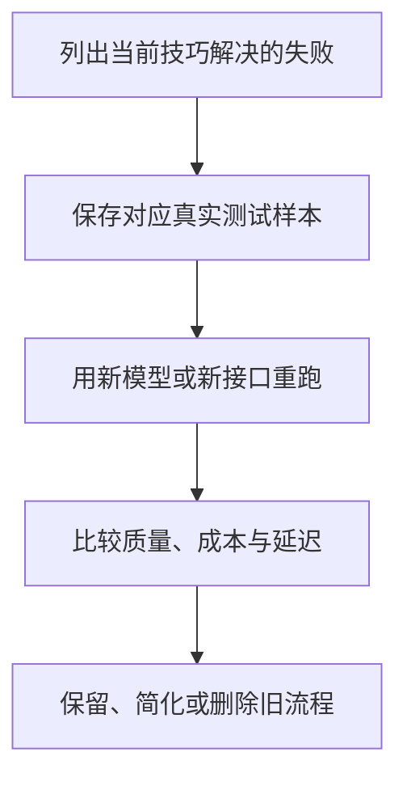

# 38. AI 更新这么快，什么能力值得长期投入？

> **场景引入**：曾经为了让模型输出 JSON 写了长提示词、正则修复和多次重试。后来接口提供结构化输出，旧方案可能该拆；业务权限和验收标准却仍然需要。

> 对应原稿：[38-AI 更新这么快，什么能力值得长期投入？](../origanl/38-AI 更新这么快，什么能力值得长期投入？.md)。原稿举的具体模型与接口时间线可能随产品变化；本文聚焦可长期复用的判断方法。

---

## 🎯 一句话定位

**优先积累业务问题、真实失败案例、可验证的验收标准和可靠接口。** 为当前模型缺点写的复杂提示词或固定反思流程可以解决眼前问题，但应定期评测，模型升级后可能不再划算。

---

## 💎 核心要点概览

| 更容易长期复用 | 需要持续复评 |
| --- | --- |
| 业务规则与权限边界 | 针对旧模型缺陷的长提示词 |
| 真实失败案例和评测集 | 某一版模型专用的重试流程 |
| 稳定工具契约与数据治理 | 只为当前接口写的适配层 |

---

## 🚀 核心总结

> **长期资产是对业务与错误的理解；模型补丁要靠版本评测决定去留。**

---

## 一、用“脚手架”和“地基”理解

模型缺少稳定 JSON 输出时，开发者会写长提示词、正则清洗、反复重试。若后来接口提供结构化输出，部分“脚手架”可拆掉。业务里的“退款只能由有权限的人发起”“报告数字必须有来源”却不会随模型升级而消失，它们是系统的地基。

| 资产 | 更可能保值的原因 |
| --- | --- |
| 真实任务与失败案例 | 可检验新模型能否解决旧问题 |
| 业务权限与工具接口 | 模型再强也需受控连接真实系统 |
| 验收标准与评测集 | 可比较质量、成本与延迟 |
| 版本、审计和状态设计 | 多步业务需要可追踪与恢复 |

提示词技巧、特定框架 API 和多轮反思策略并非没有价值，而是**价值需要重新验证**。如果新模型单次调用已达到相同质量，额外三轮自评只增加延迟和费用；如果它仍能明显减少错误，就保留。

## 二、一套判断流程

“更强模型”不自动知道你的业务里什么叫完成。关闭账号是只停登录，还是要撤销权限、处理数据与审计记录？只有业务方定义验收条件，技术升级才有比较标准。

## 三、面试口述版

> 我会把能力分为短期适配和长期资产。为旧模型格式不稳而写的复杂提示词、固定多轮自评，属于需要持续评测的适配层；真实业务案例、失败记录、权限接口、状态机制和验收标准能跨模型复用。模型升级时，我拿同一组任务比较正确率、延迟和成本，保留确有收益的旧流程，删除纯粹增加复杂度的部分。

**自测：**模型突然支持更稳定的结构化输出，哪些旧代码需要重新评估？为什么“关闭账号”的完成标准不能交给模型自己猜？

**一句话带走：能跨模型版本复用的，不是某个技巧，而是业务事实与验证能力。**

---

## 四、实践 Checklist

- [ ] 有可复现的真实任务与失败样例。
- [ ] 模型升级时同时比较正确率、时延和成本。
- [ ] 删除不再有收益的复杂补丁。
- [ ] 权限、数据来源和验收标准不依赖模型自述。

## 五、总结（一句话带走）

> **把精力投向跨版本仍有价值的业务理解、系统边界和验证能力。**
