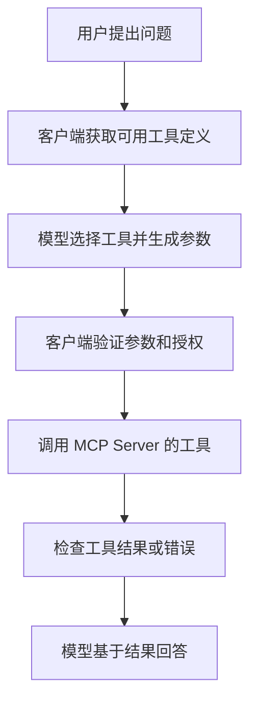

# 39. MCP 和 Function Calling 有什么区别？工具调用链路一次讲清楚

> **场景引入**：用户问北京天气。模型提出 `get_weather(city="北京")`，但实际联网、校验参数、取得结果并答复，仍要靠客户端和工具服务完成。

> 对应原稿：[39-MCP 和 Function Calling 有什么区别？工具调用链路一次讲清楚](../origanl/39-MCP 和 Function Calling 有什么区别？工具调用链路一次讲清楚.md)。

---

## 🎯 一句话定位

**Function Calling 让模型表达“想调用哪个工具、给什么参数”；MCP 让客户端与外部工具服务按共同协议发现和调用工具。** 模型不会亲自执行工具，MCP 也不会替模型决定业务目标。两者可配合，但具体应用也可能不使用其中某一项。

---

## 💎 核心要点概览

| 部分 | 它负责什么 |
| --- | --- |
| Function Calling | 让模型表达工具选择与参数 |
| MCP | 让客户端发现并调用外部工具服务 |
| 客户端执行层 | 校验授权、参数、超时与结果 |
| 业务系统 | 真正完成查询或写入 |

---

## 🚀 核心总结

> **模型说出调用意图，协议接通工具，程序决定是否允许并验证结果。**

---

## 一、查询天气的完整链路

用户问“北京今天下雨吗”。客户端从 MCP Server 获得 `get_weather` 的名称、描述和参数结构，把可用工具告诉模型。模型返回调用意图，例如 `get_weather(city="北京")`。客户端校验权限和参数后，通过 MCP 调用工具；服务返回天气结果，客户端再交给模型组织答复。

MCP 官方 [TypeScript SDK 文档](https://ts.sdk.modelcontextprotocol.io/v2/clients/calling)展示了列出工具和按名称调用工具的接口，也提醒工具返回可能带 `isError`，不能只看到内容就当成功。

## 二、两者各自不负责什么

| 机制 | 主要职责 | 不自动保证 |
| --- | --- | --- |
| Function Calling | 模型输出结构化调用请求 | 工具真实执行、参数正确、用户有权调用 |
| MCP | 工具发现、调用与结果传输等协议能力 | 模型选择正确工具、业务结果正确 |
| 业务执行器 | 授权、校验、调用、审计 | 模型意图一定正确 |

原稿说“MCP 本身不带鉴权”过于绝对。MCP 生态有 [授权规范与实现方式](https://apps.extensions.modelcontextprotocol.io/api/documents/authorization.html)，但**接入协议支持鉴权**不等于你的业务权限自动配置正确。调用退款工具仍需按用户、金额和订单状态做业务校验。

不使用 MCP 时，也可以直接在程序里定义工具并调用业务 API；不依赖模型 Function Calling 时，固定工作流也能按规则调用 MCP 工具。因此它们不是“缺一不可”的固定组合，而是分别解决不同层的问题。

## 三、面试口述版

> 我会从链路解释：MCP 帮客户端发现和调用外部工具，Function Calling 让模型产出调用意图与参数。客户端把允许的工具定义给模型，拿到调用请求后再做参数和权限校验，通过 MCP 或其他接口执行，检查返回结果，再交给模型。两者可配合但并非互相替代；是否安全仍取决于实际认证、授权和业务校验。

**自测：**模型输出 `get_weather(city="北京")` 后，哪一层真正发起网络请求？MCP Server 暴露退款工具，为什么还不能让所有用户调用？

**一句话带走：模型决定想调用什么，协议负责怎样接通，程序负责能否执行。**

---

## 四、落地 Checklist

- [ ] 工具定义、参数 Schema 和返回语义清晰。
- [ ] 客户端在执行前验证用户权限与参数。
- [ ] 工具结果按不可信外部数据处理。
- [ ] 涉及退款等写操作时另设确认和幂等。

## 五、总结（一句话带走）

> **Function Calling 与 MCP 可协同，业务安全仍由执行层负责。**
