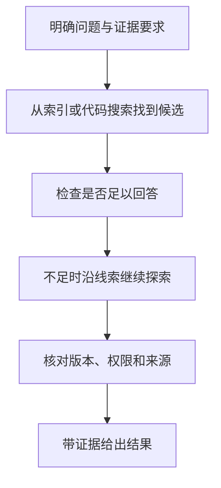

# 40. Claude Code 为什么偏向 Agentic Search？RAG 还有哪些适用场景

> **场景引入**：排查重复退款可能要沿代码调用链多轮追查；回答差旅上限则更需要从已治理的制度库中稳定找出当前条款。

> 对应原稿：[40-Claude Code 为什么偏向 Agentic Search？RAG 还有哪些适用场景](../origanl/40-Claude Code 为什么偏向 Agentic Search？RAG 还有哪些适用场景.md)。原稿对具体产品和行业占比有概括性判断；本文聚焦可迁移的检索选型思路。

---

## 🎯 一句话定位

**Agentic Search 是围绕问题多轮探索；RAG 是从已建索引中检索证据并用于回答。** 代码库里模型常需要根据第一轮结果继续查调用链；企业文档库里大量问题则需要稳定、可过滤、可引用的检索。两种方式可以组合。

---

## 💎 核心要点概览

| 问题类型 | 更直接的起点 |
| --- | --- |
| 调用链未知、要逐步发现线索 | 有工具的多轮探索 |
| 制度问答、需版本过滤和引用 | 已建索引的 RAG 检索 |
| 先找候选、再追查例外 | 两者组合 |
| 选型验收 | 正确率、引用、延迟与成本 |

---

## 🚀 核心总结

> **检索方式服从任务需要：探索路径会变时逐步搜索，资料稳定且需引用时用受控索引。**

---

## 一、用查 bug 与查制度对比

开发者问“订单退款为什么偶尔重复”。代码探索可能先搜退款入口，再顺着调用链读幂等逻辑，发现重试队列后继续查消费者。这条搜索路径要根据每一步发现调整，适合有工具的逐步探索。

员工问“当前差旅报销上限是多少”。系统若已把正式制度建立索引，按版本、地区、员工类型过滤并返回原条款，通常更直接。若资料冲突，再由 Agent 追加检索和核对来源。

| 判断条件 | 更适合的起点 |
| --- | --- |
| 下一步查什么依赖刚看到的内容 | Agentic Search |
| 大量重复问答，需稳定引用和权限过滤 | 建索引的 RAG |
| 需要先定位候选，再追踪复杂关联 | RAG 候选 + Agent 继续探索 |

不要把“LangChain 等于固定工作流、LangGraph 等于多 Agent”当成严格定义。框架只是编排工具，检索模式由任务和系统设计决定。私有文档也可以通过受控代码搜索、全文检索或混合检索使用，RAG 不局限于向量库。

## 二、生产落地还要看什么

文档解析质量、版本时效、权限隔离、召回与重排、引用追踪、延迟和成本，都可能比“选哪个名字更潮的架构”更影响结果。对同一批真实问题比较：一次检索是否足够、探索需要几轮、最终答案能否回到原文、成本是否可接受。

## 三、面试口述版

> 我会按任务的不确定性选检索方式。代码问题常需沿调用链多轮搜索，Agentic Search 有价值；企业政策等重复问答需要版本、权限过滤和出处，RAG 索引更容易稳定服务。两者也能组合：先检索候选，证据不足再让 Agent 追查。选型应看真实任务的正确率、引用质量、延迟与成本，而不是宣布某一种方法已经过时。

**自测：**排查跨多个文件的调用链，为什么一次检索可能不够？政策问答为什么要保存版本和适用范围？

**一句话带走：检索方式跟着任务走，证据质量比架构标签重要。**

---

## 四、落地 Checklist

- [ ] 明确任务是探索未知路径，还是查询已治理知识。
- [ ] 每个关键结论能回到原始文件或正式文档。
- [ ] 搜索轮数、工具权限和成本有边界。
- [ ] 用真实任务比较效果，不以产品标签决定选型。

## 五、总结（一句话带走）

> **Agentic Search 和 RAG 是可组合的检索手段，证据质量决定答案价值。**
