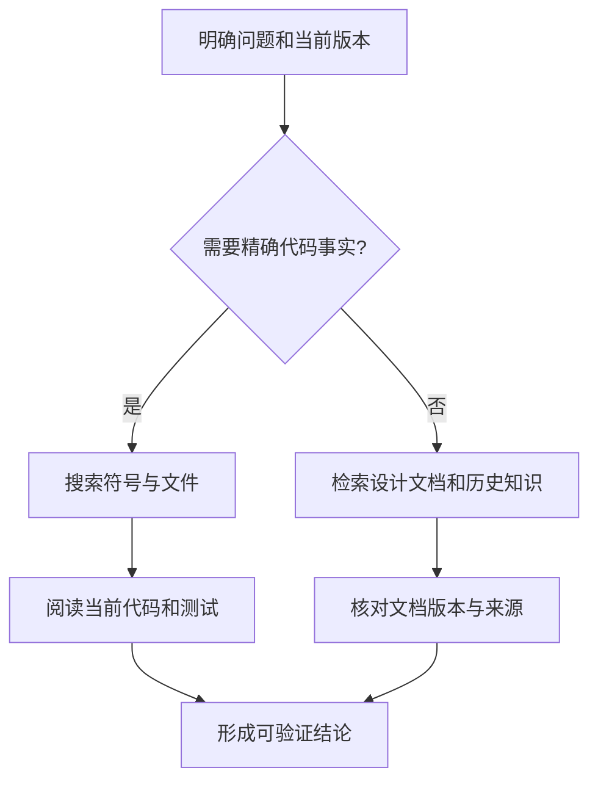

# 41. 代码搜索：实时工具检索与 RAG 怎么选

> **场景引入**：你刚修改 `CreateOrder`，索引仍指向旧实现。此时排查创建失败，应先看当前分支代码；追问“为什么曾经这样设计”，才需要找历史决策。

> 对应[原始材料](../origanl/41-Claude%20Code%20为什么偏向%20Agentic%20Search？RAG%20还有哪些适用场景（重发.md)。原稿是视频的二次还原，关于具体产品“彻底放弃 RAG”和数据存储行为的断言缺少可核查依据，以下只讨论工程选择。

---

## 🎯 一句话定位

在正在修改的代码仓库里，先看当前文件、符号定义、调用链和测试，通常比仅查一个预先构建的向量索引更可靠。对于自然语言问题、跨仓库知识和大量文档，语义检索仍有价值。两种方法可以组合，关键是让检索结果指向正确版本，并能回到原文件核验。

---

## 💎 核心要点概览

| 要求 | 先查什么 |
| --- | --- |
| 当前代码行为 | 当前分支的符号、文件和测试 |
| 历史设计原因 | 设计文档、提交记录和会议材料 |
| 跨资料问答 | 版本可追溯的语义或混合检索 |
| 安全与验收 | 权限、新鲜度、引用和实际测试 |

---

## 🚀 核心总结

> **代码事实看当前工作区，历史意图看可追溯资料；两者都需要版本核验。**

---

## 一、一个具体例子

你刚把 `CreateOrder` 改成先校验库存，再写订单。此时问“订单创建为什么失败？”旧向量索引可能仍返回改动前的实现。更稳的步骤是：定位 `CreateOrder`，查看当前分支代码，再搜索调用方、错误码与相关测试。若问题是“团队过去为什么采用先扣库存”，则还要检索设计文档和历史决策记录。前者偏实时文件搜索，后者偏知识检索。

## 二、选型要比较的四件事

1. **准确度**：函数名、错误码、配置键适合字符串或符号搜索；“限流策略为什么改变”更适合语义搜索。单靠字符串可能找不到同义表达，单靠向量也可能误召回近似代码。
2. **新鲜度**：工作区文件是当前状态；索引是否新鲜取决于增量更新、分支隔离和版本标记。RAG 并非必然过期，实时搜索也不保证读到了尚未保存的编辑器缓冲区。
3. **代价**：小仓库可从文件搜索起步。跨仓库、大量非结构化资料和重复查询时，索引的建设成本可能换来更好的召回与速度，要用实测判断。
4. **权限**：两条路径都可能泄露敏感内容。向量库需控制入库、租户和删除；实时工具需控制文件读取范围、日志、外发和模型服务的数据策略。不能推断“只在内存中读取就绝不留副本”。

## 三、落地做法

准备一组真实问题，分别测试精确搜索、向量检索和混合检索；记录命中正确文件的比例、引用版本、延迟和费用。答案中保留文件路径与行号，遇到代码结论再用测试或静态检查验证。对于高风险操作，不让检索结果直接变成执行授权。

**面试可以这样说：**“代码库问题先确定分支和版本，再用符号与文本搜索找到当前实现；架构意图和跨文档问题用语义检索补充。最终回到原文件与测试核验，并通过同一套问题集比较召回、新鲜度、延迟和成本。”

**自检：**用户问‘昨天的设计决定’与‘当前分支某函数的返回值’，你会用同一个索引回答吗？为什么？

---

## 四、落地 Checklist

- [ ] 先确认分支、文件版本和索引更新时间。
- [ ] 代码结论能回到文件与行号，并通过测试或静态检查核验。
- [ ] 历史设计结论有来源文档及时间。
- [ ] 两种检索都遵守文件与租户权限。

## 五、总结（一句话带走）

> **检索策略跟着问题和版本走，不跟着工具标签走。**
