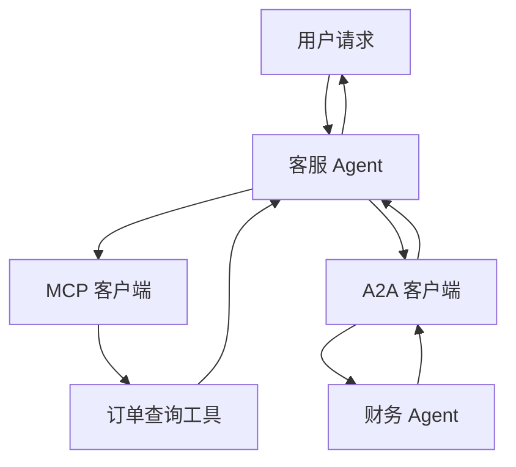

# 42. 多 Agent 协作：MCP 与 A2A 分别解决什么

> **场景引入**：客服 Agent 要查退款进度，可能连接订单查询工具；若需要另一团队的专业 Agent 处理复杂争议，则是任务委托。两种连接对象不同。

> 对应[原始材料](../origanl/42-多%20Agent%20如何协作？MCP%20与%20A2A%20的分工讲清楚.md)。原稿为视频二次还原。协议细节以 [MCP 文档](https://modelcontextprotocol.io/docs/learn/architecture) 和 [A2A 规范](https://a2a-protocol.org/v1.0.1/specification/) 为准。

---

## 🎯 一句话定位

MCP 规范应用怎样连接工具、资源与提示；A2A 规范一个 Agent 怎样发现并委托另一个 Agent 完成任务。前者围绕“用什么能力”，后者围绕“交给谁做”。系统内简单的函数调用、消息队列和工作流也能协作，不必为了“多 Agent”三个字强行引入协议。

---

## 💎 核心要点概览

| 协作对象 | 典型机制 | 重点 |
| --- | --- | --- |
| 工具、资源 | MCP 或直接接口 | 能力发现与调用 |
| 另一个 Agent | A2A 或业务任务协议 | 委托、状态与产物 |
| 本系统内固定步骤 | 函数或工作流 | 简单、可控 |

---

## 🚀 核心总结

> **先确定是调用能力，还是委托任务，再决定需要哪种协议。**

---

## 一、以订单售后为例

客服 Agent 收到“帮我确认退款进度”。它可通过 MCP 连接订单查询工具，读取该用户被授权查看的订单。如果退款处理由独立的财务 Agent 承担，客服 Agent 可以通过 A2A 发现它支持的任务并提交请求，随后跟踪任务状态，直到拿到结果或需要人工处理。

## 二、A2A 中值得理解的概念

- **Agent Card**：描述服务身份、能力、端点和支持的交互方式，供其他 Agent 发现。读到名片不等于得到访问权限；认证、授权与信任校验仍要单独设计。
- **Task**：跨 Agent 请求的工作单元。调用方应保存任务 ID，按协议处理状态、结果与错误。长任务需要超时、轮询或推送，并在重复投递时避免重复副作用。
- **Artifact 与消息**：区分过程沟通和最终产物。不要把一段自然语言“完成了”直接当作业务系统已成功提交。

## 三、项目落地的五步

1. 先列出能力边界：谁拥有订单数据，谁有退款审批权，谁只负责对话。
2. 仅在跨进程、跨团队或跨框架需要统一协作协议时引入 A2A；工具连接需求再考虑 MCP。
3. 为每次调用传播用户身份、租户、追踪 ID 和业务幂等键，检查服务端权限。
4. 规定超时、取消、失败重试和人工接管，尤其避免退款重复提交。
5. 评估完成率之外，还看错误路由率、工具结果正确率、人工接管率和尾部延迟。

**面试可以这样说：**“MCP 用于 Agent 连接工具与数据；A2A 用于 Agent 之间发现、委托和跟踪任务。我先用业务边界决定是否需要多 Agent，再设计身份传递、幂等、超时与可观测性。两个协议可组合，但不替代业务权限。”

**自检：**A2A Agent Card 声称‘可退款’，调用方是否可以直接执行退款？还缺什么检查？

---

## 四、落地 Checklist

- [ ] 业务边界能说明为何需要工具或远端 Agent。
- [ ] 远端身份、权限与敏感数据范围已校验。
- [ ] 长任务有状态、超时、取消和幂等处理。
- [ ] 协议返回结果经过本地业务规则复核。

## 五、总结（一句话带走）

> **MCP 接工具，A2A 交任务；两者都不替代业务授权。**
