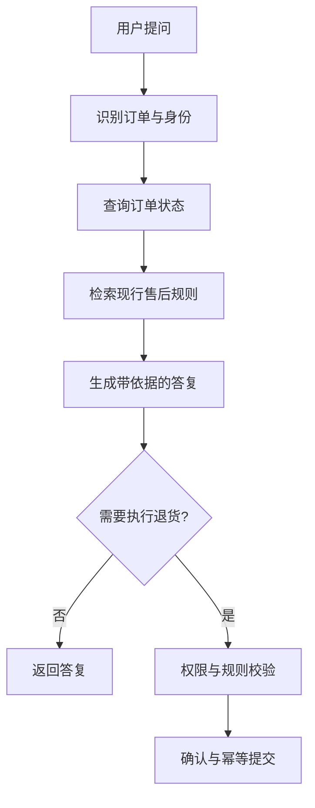

# 43. 从零做一个能经得起追问的 Agent 项目

> **场景引入**：一个客服 Demo 会说“可以退款”，却没有查询订单、核对当前规则或确认用户身份。面试官追问“接口超时怎么办”，项目就露出缺口。

> 对应[原始材料](../origanl/43-AI面试总翻车？从0落地智能体项目.md)。原稿含课程推广与未经核验的身份、效果描述；本文只提炼可实践的项目方法。

---

## 🎯 一句话定位

面试中能讲清“解决了什么问题、为什么这么设计、故障时怎样定位”，比列出 LangChain、RAG、向量库等名词更有说服力。最小可行项目也可以很小，但必须有真实输入、可观察输出、明确失败处理和评估记录。

---

## 💎 核心要点概览

| 项目阶段 | 可验证产出 |
| --- | --- |
| 定义目标 | 用户问题、正确答案和完成标准 |
| 读取事实 | 订单实时状态与现行规则来源 |
| 安全执行 | 权限、确认和幂等 |
| 排错评测 | Trace、失败样例和回归结果 |

---

## 🚀 核心总结

> **用一个小业务闭环证明能力，比堆框架名更经得起追问。**

---

## 一、用电商售后做练习

目标不是“做一个会聊天的客服”，而是：用户询问某笔订单能否退货时，系统读取订单状态和当前售后规则，给出带依据的答复；只有在获得授权并经过校验后，才可能提交退货申请。把“答复问题”和“改变业务状态”分开，是项目设计的第一步。

## 二、三个追问，逐个准备证据

### 1. 解决了什么业务问题？

定义原流程：人工查订单、翻规则、回复用户。先采集少量脱敏工单，统计常见问题、人工处理时间和错误类型。项目目标可以是降低某类问答的人工查找时间，但不要在没有实验时编造节省比例。明确不可自动处理的情况，例如身份不匹配、规则冲突、争议订单。

### 2. 为什么这样选型？

订单状态来自实时业务 API；售后规则来自可更新的知识库；模型负责理解提问和组织答案。每一个组件对应一种数据特性。先用规则和单次工具调用完成基础闭环，再在确实需要多步决策时引入 Agent Loop。对工具参数做 schema 校验，业务系统再次校验权限。

### 3. 线上故障怎么查？

按请求 ID 查看：输入分类是否错、订单工具是否超时、检索是否找到正确版本、模型是否引用了证据、提交工具是否重复执行。分别设置超时和降级：查不到订单就请用户补信息；找不到规则就转人工；提交失败要报告真实状态而非猜测成功。

## 三、最小交付清单

- 一张请求链路图和数据权限说明。
- 至少覆盖正常、缺信息、规则冲突、工具超时、重复请求的用例集。
- 每次运行保存脱敏 trace、结果与失败分类，能复现一次错误。
- 写出一页复盘：原方案、实际指标、失败样例和下一步改进。

**面试口述：**“我做的是售后问答与申请分流。订单状态走实时 API，规则走可追溯检索；模型只负责理解和表达。执行前由业务接口重新鉴权并用幂等键防重复。排障按 trace 分辨检索、模型和工具故障，用固定用例回归。”

**自检：**如果模型说‘退款已提交’，但接口返回超时，你的系统该展示什么？

---

## 四、实践 Checklist

- [ ] 能复现一次正常请求和一次失败请求。
- [ ] 事实问答与真实业务写操作分开。
- [ ] 超时后查询实际状态，不把模型表述当结果。
- [ ] 面试中清楚区分自己实现与课程示例。

## 五、总结（一句话带走）

> **项目的说服力来自真实边界、失败处理和可核查结果。**
