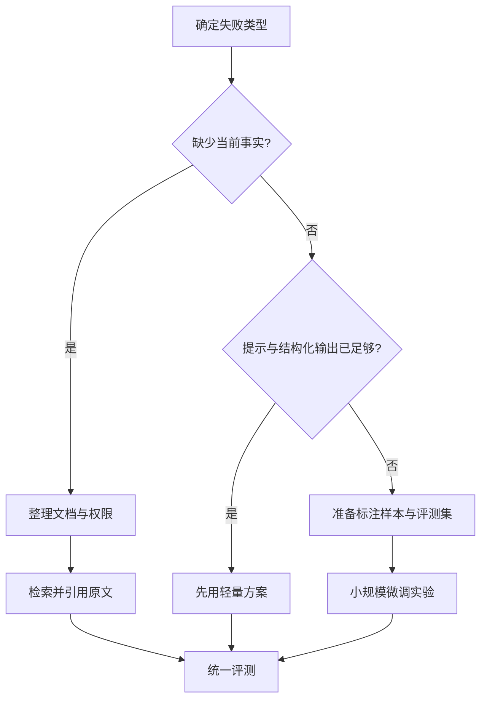

# 44. 企业知识库：RAG 与微调怎样选

> **场景引入**：公司昨天改了退货政策。若需要今天就回答新规则并提供出处，更新可检索资料通常比重新训练模型更直接。

> 对应[原始材料](../origanl/44-企业知识库选%20RAG%20还是微调？五个维度做判断.md)。原稿中的“90% 场景”“固定天数/价格/样本量”等数字没有可核查依据，本文不把它们当通用结论。

---

## 🎯 一句话定位

RAG 在回答时把外部资料取出来供模型参考；微调通过训练改变模型参数。前者适合提供当前事实与出处，后者更适合在大量高质量样本证明有必要时调整稳定的行为模式。两者都不能替代数据治理与评估。

一个容易记的比喻：RAG 是“考试时查资料”，微调是“练习答题方式”。但比喻有边界：即便资料正确，模型仍可能误读；即便训练过，也不保证事实准确。

---

## 💎 核心要点概览

| 主要问题 | 优先验证 |
| --- | --- |
| 缺少最新事实与出处 | RAG 与资料治理 |
| 输出格式不稳定 | 接口结构化输出与程序校验 |
| 稳定行为模式仍不达标 | 在高质量样本上评估微调 |
| 选择方案 | 同一任务集比较质量、维护和成本 |

---

## 🚀 核心总结

> **需要可更新、可引用事实时先看检索；需要稳定行为改变时再评估训练。**

---

## 一、五个判断维度

| 维度 | 优先考虑 RAG 的信号 | 可以研究微调的信号 |
| --- | --- | --- |
| 知识变化 | 价格、制度、产品规则频繁更新 | 稳定且可用样本描述的行为 |
| 来源要求 | 需要展示原文件、版本与依据 | 主要评估输出风格或任务习惯 |
| 数据条件 | 有原始文档但缺少标注样本 | 有足够、干净、代表性的输入输出样本 |
| 成本 | 能承担检索和上下文开销 | 训练、评测、部署后仍有净收益 |
| 任务类型 | 查规定、回答当前事实 | 一致的分类、改写或特定流程表现 |

上述是判断线索，不是自动选型公式。成本必须用本项目的查询量、检索延迟、模型价格、训练成本和维护成本测算。微调后的每次推理也有费用，不能笼统说“推理更便宜”。

## 二、常见误判

- “要 JSON 就必须微调”：先用结构化输出、schema 校验与重试。
- “接上 RAG 就能溯源”：必须保留文档 ID、版本、片段位置，还要检查答案是否真的由所引片段支持。
- “微调能记住所有内部知识”：参数不是可靠数据库，也不提供单条事实的可编辑记录。
- “生产 RAG 很简单”：解析表格、权限过滤、过期文档和评测往往是主要工作。

## 三、推荐实验顺序

先建立几十到几百条代表性问题的评测集，记录正确答案与应引用的文档版本。比较基础提示、提示加结构化约束、RAG、以及有条件的微调。把正确性、可追溯性、延迟、成本和人工复核率一起看。对医疗、法律等高风险问题，还需专业人员审查，不能因为能引用就自动认为结论正确。

**面试口述：**“企业知识库先区分缺事实还是缺稳定行为。事实要能更新和溯源，通常先验证 RAG；格式问题先试结构化输出。只有有代表性样本、明确评测收益时，才考虑微调，并用同一数据集比较质量和成本。”

**自检：**公司昨天更新了退货政策，重新微调模型和更新可检索规则，哪个更容易给出可核对的现行依据？

---

## 四、选型 Checklist

- [ ] 明确失败是知识缺口、格式问题还是行为模式问题。
- [ ] 资料更新频率、权限与引用要求已确定。
- [ ] 微调样本有代表性并有独立评测集。
- [ ] 用同一批真实问题比较两条路线的质量与维护成本。

## 五、总结（一句话带走）

> **RAG 与微调不是互斥口号，先定位失败类型再选择或组合。**
