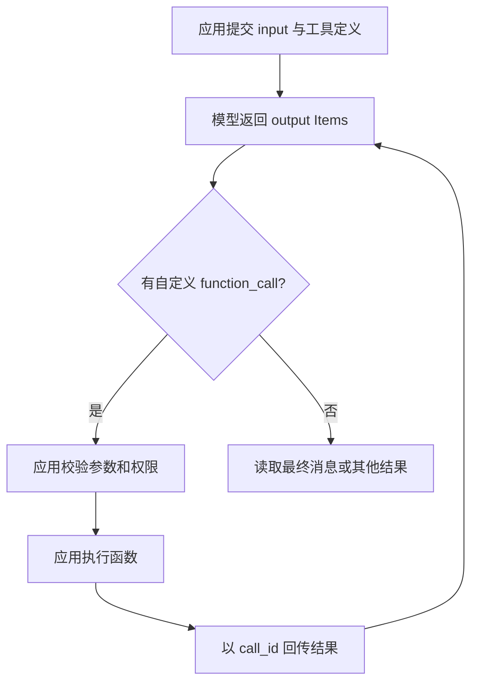

# 45. Responses API 与 Chat Completions：做 Agent 时怎么选

> **场景引入**：应用要让模型选择工具、执行数据库查询、把结果送回模型，再生成最终答复。API 能表达调用流程，但数据库仍由应用执行。

> 对应[原始材料](../origanl/45-Agent%20时代为什么需要%20Responses%20API？三大区别讲清楚.md)。本篇按 [OpenAI 官方迁移文档](https://developers.openai.com/api/docs/guides/migrate-to-responses) 与 [Function Calling 文档](https://developers.openai.com/api/docs/guides/function-calling) 校正原稿中的误述。

---

## 🎯 一句话定位

Responses API 提供更适合工具和多模态任务的类型化 `input`/`output`、可选的服务端会话衔接和 OpenAI 内置工具。它适合新建的复杂 Agent 工作流；简单聊天或已有 Chat Completions 应用也可以继续使用。**自定义函数仍由你的应用执行**，不能认为把函数声明放进请求后，服务端就会替你完成业务动作。

---

## 💎 核心要点概览

| 选型维度 | 要核对什么 |
| --- | --- |
| 输入输出 | 是否需要类型化的工具、多模态内容 |
| 会话衔接 | 是否使用服务端状态，如何记录调用链 |
| 工具执行 | 内置工具与应用自定义函数的边界 |
| 迁移代价 | 现有代码、质量、时延与费用 |

---

## 🚀 核心总结

> **Responses API 提供更多编排能力，业务工具的执行与授权仍在应用侧。**

---

## 一、三处关键差异

### 1. 数据结构

Chat Completions 以 `messages` 为中心；Responses 把普通消息、`function_call`、`function_call_output` 等表示为不同的 Item。处理 Agent 结果时，不能只读取 `output_text` 后忽略工具调用。`reasoning` Item 也不等于能拿到模型完整、原始的内部思维链，需按官方可见字段与数据策略理解。

### 2. 会话状态

Responses 可用 `previous_response_id` 衔接先前响应，也可由应用自行传回历史 Items，还可使用 Conversations API。选择哪一种取决于隐私、可控性与管理需要。`previous_response_id` 简化了客户端传输与状态维护，**不代表历史上下文自动免费**；应按实际账单与 token 用量评估。顶层 `instructions` 需要按官方要求在后续请求中重新提供。

### 3. 工具集成

Responses 可配置 OpenAI 托管的内置工具，例如 web search 或 file search；这些工具的运行方式与自定义函数不同。自定义 `function_call` 出现后，应用仍需读取参数、执行业务函数、回传与 `call_id` 对应的结果，并控制超时、幂等和权限。Chat Completions 也支持函数调用，因此差异不能概括成“旧接口不能做 Agent”。

## 二、选型与迁移提示

新项目若要组合内置工具、类型化输出和服务端状态，可优先试 Responses；存量项目若只做简单问答，迁移收益可能不大。迁移时逐项检查输入格式、输出解析、工具循环、会话策略和计费。结构化输出也不是 Responses 独有能力，不应以“必须输出 JSON”为唯一迁移理由。

**面试口述：**“Responses 的主要变化是类型化 Items、可选状态衔接和内置工具。自定义函数仍在应用侧执行，结果要按 call ID 回传。迁移收益要结合现有代码、工具需求与实际 token 成本判断。”

**自检：**模型返回 `function_call` 要查询客户余额时，谁执行数据库查询？谁负责权限校验？

---

## 三、迁移 Checklist

- [ ] 明确需要哪些内置或自定义工具能力。
- [ ] 自定义函数的执行、授权和结果回传由应用负责。
- [ ] 旧调用与新调用在同一评测集上比较行为。
- [ ] 记录 API、模型、工具 Schema 和成本变化。

## 四、总结（一句话带走）

> **选择 API 看任务需要，不把模型返回的函数调用当作已执行的业务结果。**
