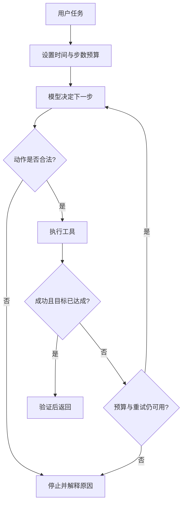

# 46. Agent 死循环与幻觉：四道工程防线

> **场景引入**：库存工具连续超时，Agent 一次次重试，最后还说“库存已确认”。问题同时涉及无进展循环和无证据完成声明。

> 对应[原始材料](../origanl/46-Agent%20死循环、幻觉怎么兜底？上线必备四道防线.md)。

---

## 🎯 一句话定位

Agent 的下一步由模型决定，因而可能重复调用工具、误读结果，甚至把失败说成成功。生产系统要同时控制**运行预算、终止条件、工具失败、输入输出校验**。这四道防线分别挡住失控消耗、无休止执行、异常传播和错误业务动作。

---

## 💎 核心要点概览

| 防线 | 挡住什么 |
| --- | --- |
| 运行预算 | 无限步骤、耗时与费用 |
| 终止条件 | 反复动作却无状态进展 |
| 工具失败处理 | 超时误判、盲目重试 |
| 输入输出校验 | 越权动作与无依据结论 |

---

## 🚀 核心总结

> **Agent 可以动态规划，但资源、动作和完成声明必须由程序约束。**

---

## 一、四道防线怎样落地

1. **预算**：限制总步数、总耗时、总 token、单工具次数和花费。只设“最多 15 步”不够，单个工具也可能卡住，必须有超时和取消。
2. **终止条件**：在任务开始时写出可检验的完成标准。例如“获得订单状态并给出引用”即可结束；不以模型自称“完成”代替业务证据。
3. **工具失败处理**：区分可重试的临时错误和不可重试的参数、权限错误。指数退避要有上限；写操作重试要有幂等键。数据拿不到时明确说明，必要时转人工。
4. **硬校验**：调用前检查 schema、金额范围、资源归属；输出前核对关键数字、引用与工具状态。支付、删除等动作的权限校验应在业务服务完成。

## 二、怎样识别死循环与伪进展

连续几次出现相同的工具名、相同参数和相同结果，且任务状态没有进展，就应触发循环检测。仅因模型“换个说法”不算进展；可记录状态指纹。触发后要终止或请求人介入，不能让模型无限自我反思。原稿提出逐步调低温度，但它不是可靠的终止机制，也不适用于所有模型接口。

**面试口述：**“我会设步数、时间和费用预算；定义可验证完成条件；工具失败按错误类型有限重试，写操作用幂等；执行前后用代码校验权限、参数和结果。重复动作且状态无进展时熔断，并保留 trace 供复盘。”

**自检：**库存查询连续返回超时，模型连续重试十次。应在哪一层、依据什么条件停止？

---

## 三、生产环境 Checklist

- [ ] 每项任务有步数、时间、费用和重试预算。
- [ ] 完成状态来自可核验的工具或业务事实。
- [ ] 写操作幂等，超时后先查实际状态。
- [ ] 重复工具调用且状态无进展时熔断并保留 Trace。

## 四、总结（一句话带走）

> **让 Agent 会停、会核实、会承认失败，才有上线基础。**
