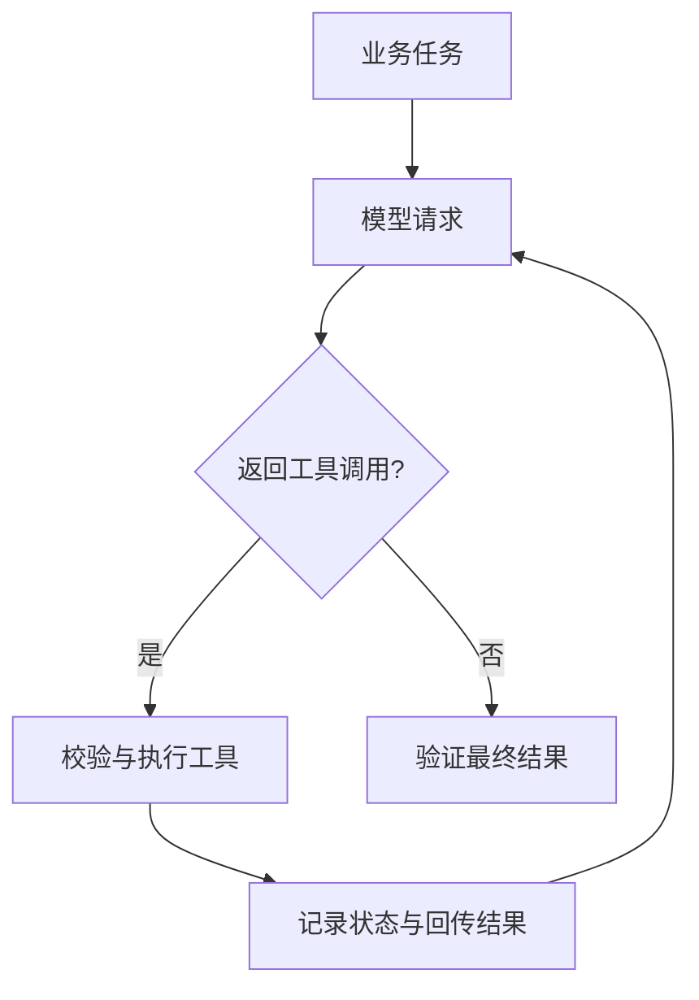

# 47. 自写 Agent Loop 还是使用框架

> **场景引入**：框架能快速接数据库，却无法在写入前插入所需审批。此时“开发快”并不能抵消业务边界不满足的风险。

> 对应[原始材料](../origanl/47-手搓%20Agent%20还是用%20LangChain？把工程取舍讲清楚.md)。原稿中项目星数、个别企业迁移故事等随时间变化或无法核验，本文不据此下结论。

---

## 🎯 一句话定位

“手搓”通常指自己掌握工具循环、状态与错误处理；使用 LangChain、LangGraph 等框架则是复用已有的编排与集成能力。真正的问题是：项目要求哪些行为必须可控，团队愿意维护多少基础设施。

这张图无论用框架还是自行实现都存在。框架省去重复代码，却不自动解决权限、可观测性、幂等或正确性；自行实现更透明，却要自己承担升级、并发和故障恢复。

---

## 💎 核心要点概览

| 维度 | 要比较什么 |
| --- | --- |
| 开发速度 | 最小闭环与后续扩展速度 |
| 控制能力 | 状态、审批、取消与权限插入点 |
| 运维 | Trace、错误恢复和版本兼容 |
| 长期成本 | 团队维护能力与框架升级代价 |

---

## 🚀 核心总结

> **先列业务必须控制的环节，再比较自写与框架的实际代价。**

---

## 一、四个取舍维度

| 维度 | 自写循环 | 使用框架 |
| --- | --- | --- |
| 起步 | 小流程简单直观 | 常见集成更快 |
| 运行控制 | 状态、工具、上下文可按需设计 | 需确认扩展点是否足够 |
| 维护 | 自己负责重试、流式与版本兼容 | 需跟进框架版本与抽象变化 |
| 排障 | 链路短，但观测要自建 | 可复用工具，也可能增加定位层次 |

## 二、用最小业务闭环做试验

用同一个“查询订单并解释售后规则”任务做两个最小实现。比较代码量之外的指标：工具错误能否复现；中途取消是否生效；一个调用的 trace 是否完整；切换模型或存储的修改范围；升级依赖后回归是否通过。只读工具并发与写工具串行是业务约束，不能假设框架默认替你保证。

若流程只有一两个工具，直接使用模型 API 加一个清晰循环通常够用。若有复杂状态机、人机交接、持久化恢复和大量集成，成熟框架可能更经济。混合方式也常见：框架负责状态和可视化，关键工具由业务服务执行校验。

**面试口述：**“我不凭框架名选型。先做最小业务闭环，列出状态持久化、取消、权限、工具动态选择与追踪要求，再比较自写与框架的可控性、开发和维护成本。无论哪种方式，业务校验留在工具服务。”

**自检：**某框架能快速接数据库，但无法在写入前插入审批，适合直接上线吗？

---

## 三、选型 Checklist

- [ ] 业务要求的审批、持久化和取消能力均可实现。
- [ ] 工具执行前后能插入权限与结果校验。
- [ ] 故障可追踪、可重放，框架升级可回归。
- [ ] 用同一任务比较质量、开发和维护成本。

## 四、总结（一句话带走）

> **框架是实现手段；业务边界和可验证结果才是选型标准。**
