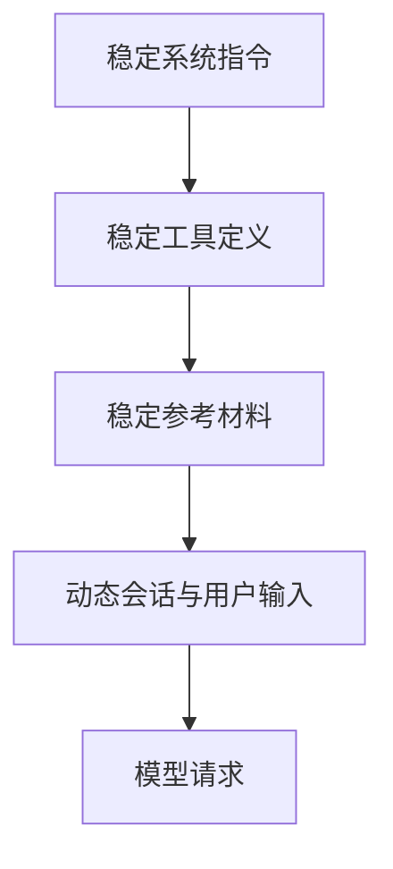

# 48. Prefix Caching：为什么相同开头可能更快

> **场景引入**：多轮问答每次都带相同系统规则。若请求前缀完全一致，服务端可能复用已算过的部分；若首行总写当前毫秒时间，复用机会会降低。

> 对应[原始材料](../origanl/48-Prefix%20Caching%20前缀缓存：长对话为什么能降本提速？.md)。缓存实现和计费因服务商而异；不要把原稿的折扣或某种数据结构当作通用事实。参考 [OpenAI Prompt Caching](https://developers.openai.com/api/docs/guides/prompt-caching)。

---

## 🎯 一句话定位

模型处理输入时先计算前缀的中间状态。如果后续请求从开头起有一段相同 token，服务端可能复用这段计算，减少首字延迟和部分输入成本。它并不意味着“对话越长越便宜”：新增加的内容仍需处理，缓存能否命中还受模型、长度门槛、缓存保留时间和服务端调度影响。

---

## 💎 核心要点概览

| 输入位置 | 建议 |
| --- | --- |
| 稳定系统规则和工具说明 | 尽量保持前缀一致 |
| 当前时间、用户问题、实时数据 | 放在动态部分 |
| 性能判断 | 看命中 token、TTFT、总费用和正确率 |

---

## 🚀 核心总结

> **前缀缓存省的是相同前缀的重复计算，收益要以真实请求数据验证。**

---

## 一、为什么顺序重要

假设两次请求的开头都是同一段系统指令和工具定义，后面用户问题不同。共同前缀可成为缓存候选。若第一行放入每次变化的时间戳，匹配很早就中断，后面即便相同也可能无法复用。实际命中规则与最小长度以提供商文档为准；不能推断“前面一个字变化，所有服务商的缓存一定全部失效”。

## 二、工程做法

把稳定指令、工具 schema 和可复用资料放在前面；把会话 ID、时间和当前问题放在后面。保持工具列表顺序、序列化格式和版本稳定。对每次请求记录输入 token、缓存命中 token、首字延迟与总成本，做 A/B 对比。若稳定材料含敏感信息，要先确认服务商的数据保留和租户隔离策略。

**KV Cache 与 Prefix Caching 的关系：**KV Cache 是 Transformer 推理用的中间表示；Prefix Caching 是在满足条件时跨请求复用前缀计算的服务能力。不同推理引擎可能采用不同的块管理、哈希和淘汰方式，不能把 radix tree 或 LRU 当成唯一实现。

**面试口述：**“我会把稳定内容放在请求前部，动态内容后置，观察缓存命中 token 与首字延迟。缓存命中取决于前缀一致性和服务端规则，收益要以真实调用数据验证。”

**自检：**每次请求都在系统提示首行写当前毫秒时间，会怎样影响前缀复用？

---

## 三、落地 Checklist

- [ ] 稳定内容在前，动态变量在后。
- [ ] 不为缓存命中牺牲权限隔离与事实新鲜度。
- [ ] 记录命中 token、首字延迟、完整任务费用。
- [ ] 对比优化前后答案质量。

## 四、总结（一句话带走）

> **让可复用的前缀稳定，同时让实时事实继续保持实时。**
