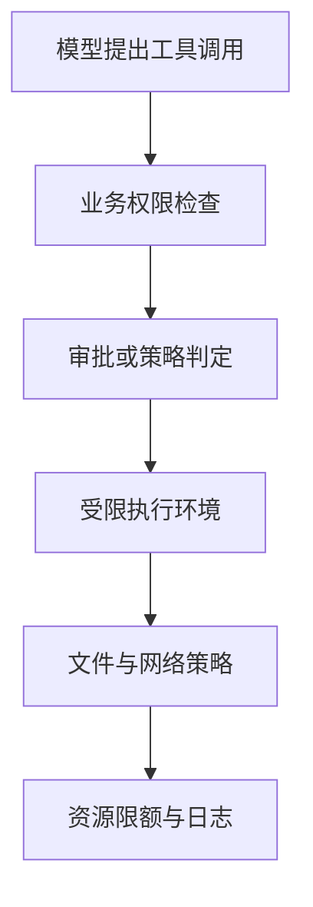

# 49. Agent 执行沙箱：先定权限边界

> **场景引入**：Agent 在隔离工作目录中运行，看似安全，却仍能读取宿主机云凭证并联网外发。只隔离文件路径的一部分，不能称为完整沙箱。

> 对应[原始材料](../origanl/49-Agent%20沙箱机制怎么做？从权限边界到环境隔离.md)。原稿列举具体厂商底层方案与性能数字，未逐项核验；本文聚焦可复用的设计原则。

---

## 🎯 一句话定位

**沙箱的作用是把模型和外部内容带来的错误指令限制在可控范围内；限制要由执行环境强制实施。**

---

## 💎 核心要点概览

| 边界 | 具体控制 |
| --- | --- |
| 文件 | 只挂必要目录，写入隔离工作区 |
| 网络 | 限制目的地与外发能力 |
| 进程 | 限制子进程和系统调用能力 |
| 资源 | 设置 CPU、内存、时间和存储上限 |
| 业务 | 用户身份、审批与审计独立校验 |

---

## 🚀 核心总结

> **提示词不能替代执行隔离；沙箱也不能替代业务授权。**

---

## 一、为什么需要沙箱

Agent 可能根据不可信网页或文件中的提示去运行命令。只靠过滤 `rm -rf` 等字符串容易被脚本、编码、路径别名绕过。可靠边界应由操作系统或隔离环境强制执行：进程即使得到错误指令，也不能越权访问文件、网络和资源。

## 二、四类隔离边界

1. **文件系统**：只挂载需要的目录，尽量只读；写入使用临时工作区。路径检查要考虑符号链接、`..` 与检查后再替换文件的竞态。工作树隔离可保护主仓库改动，但不等于操作系统沙箱。
2. **网络**：默认限制出站目的地，明确是否可访问内网、元数据服务和外部网站。避免把密钥注入不可信进程。
3. **进程与系统调用**：限制用户身份、特权、可用系统调用或采用容器/虚拟机隔离；隔离强度按威胁模型选择。
4. **资源**：限制 CPU、内存、磁盘、进程数和执行时间，避免错误循环拖垮宿主机。

## 三、审批与沙箱各管什么

审批判断“用户是否同意此动作”，沙箱限制“动作即使被执行最多能影响哪里”。二者互补。向用户展示命令时，还应展示工作目录、目标文件和网络目标；审批通过后仍必须在受限环境运行。高风险操作尽量由独立的业务 API 执行，不直接把生产凭证交给 shell。

**落地顺序：**列出工具可读写的资源；建立默认拒绝策略；用最小权限运行；对写操作设计回滚或快照；记录每次工具调用的输入、结果和拒绝原因；用越权用例验证边界。不要仅凭产品名称推断其沙箱强度。

**面试口述：**“沙箱是执行权限边界，不是关键词黑名单。我会限制文件、网络、进程和资源，写入放在隔离工作区；业务侧再做用户身份与审批。用路径穿越、符号链接和网络外发等用例验证。”

**自检：**Agent 在 worktree 中运行，但能读取宿主机的云凭证。这算完成隔离了吗？

---

## 四、生产环境 Checklist

- [ ] 文件、网络、进程和资源限制由操作系统或运行时执行。
- [ ] 默认无权读取宿主密钥和无关目录。
- [ ] 高风险动作还要做用户身份与审批校验。
- [ ] 用路径穿越、符号链接和外发测试验证隔离。

## 五、总结（一句话带走）

> **真正的沙箱要让错误指令即使被执行，也无法越过预定边界。**
