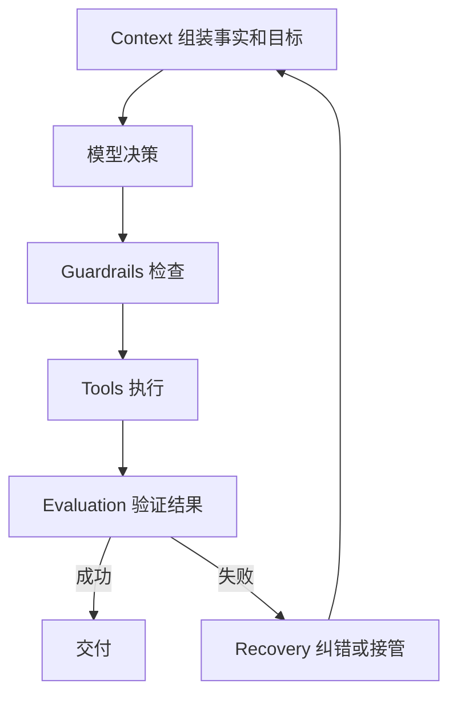

# 50. Agent Harness：把模型变成可运行系统

> **场景引入**：模型说“订单地址已改好”，但工具返回超时，系统也没重新查订单。只有模型建议，没有执行、验证和恢复，任务就没有闭环。

> 对应[原始材料](../origanl/50-Harness%20的五要素：除了%20Context%20和%20Tools，还要懂什么？.md)。原稿所称“五要素”适合作为设计检查表，并非行业统一标准；具体产品代码比例与权限模式数字不作为事实引用。

---

## 🎯 一句话定位

模型生成下一步建议；Harness 管理它看到什么、能调用什么、怎样验证、失败后怎样恢复。用五个视角检查系统：Context、Tools、Guardrails、Evaluation、Recovery。记忆和规划可以实现为这些环节中的具体能力，不必争论它们是否“顶层要素”。

---

## 💎 核心要点概览

| 视角 | 核心问题 |
| --- | --- |
| Context | 当前模型需要哪些事实与状态 |
| Tools | 如何接触外部世界 |
| Guardrails | 哪些动作必须被系统挡住或确认 |
| Evaluation | 怎样证明任务真的完成 |
| Recovery | 失败后怎样恢复、补偿或接管 |

---

## 🚀 核心总结

> **Harness 让模型建议进入受控的执行、验证与恢复流程。**

---

## 一、五个视角对应什么工作

| 视角 | 关键问题 | 常见做法 |
| --- | --- | --- |
| Context | 模型此刻需要哪些事实？ | 保留目标、关键状态和相关工具结果；裁剪噪声 |
| Tools | 如何安全接触外部世界？ | 明确 schema、超时、权限与幂等 |
| Guardrails | 哪些动作绝对不能自动执行？ | 代码校验、沙箱、审批、最小权限 |
| Evaluation | 怎样知道任务真的完成？ | 测试断言、业务状态、人工抽检 |
| Recovery | 失败之后怎么办？ | 有限重试、补偿、回滚、人工接管 |

## 二、用订单修改走一遍

用户要求把订单地址改为新地址。Context 提供订单 ID 与已确认的新地址；Tools 有查询和修改接口；Guardrails 校验订单归属及是否已发货；Evaluation 重新查询地址确认变化；Recovery 在接口超时时先核对实际状态，避免盲目重试。仅凭模型输出“已修改”不能算完成。

## 三、常见误区

不要把“让模型自评”当成唯一验证。工具输出也可能被提示词注入，应按数据处理，不赋予新的系统权限。恢复不是无条件重试：不可重复的支付和写入必须先查状态或使用幂等键。

**面试口述：**“Harness 是模型之外的运行与治理层。我从上下文、工具、约束、验证、恢复五个视角设计链路；每次高风险动作都由代码检查，每个完成声明都要有外部证据。”

**自检：**模型说‘测试通过’，但没有测试进程退出码和日志，Evaluation 是否完成？

---

## 四、落地 Checklist

- [ ] 目标、关键事实与当前状态能进入 Context。
- [ ] 工具权限、参数和失败语义明确。
- [ ] 高风险动作由执行层拦截或审批。
- [ ] 完成声明能找到外部证据，失败能恢复或接管。

## 五、总结（一句话带走）

> **模型负责提出下一步，Harness 负责让下一步安全、可验证地落地。**
