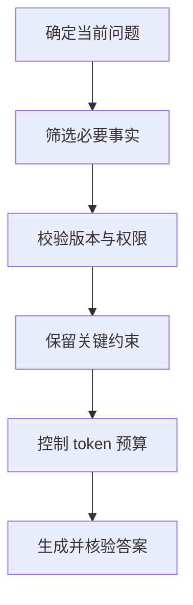

# 51. 上下文窗口越大，回答就越好吗？

> **场景引入**：用户只问如何修改发票抬头，系统却附上整本手册与几百轮历史。窗口装得下，答案仍可能被旧规则或无关内容带偏。

> 对应[原始材料](../origanl/51-大模型上下文窗口越大越好吗？关键是精准投喂.md)。

---

## 🎯 一句话定位

上下文窗口是一次推理能处理的 token 容量，容量大不等于模型会正确使用其中每条信息。真正要优化的是**任务相关性、来源可靠性和信息位置**。长输入可能带来更高延迟与费用，也可能包含冲突信息；具体效果要用目标模型和业务问题实测。

例如用户只问“发票抬头怎么修改”，把整本产品手册、所有历史工单和几百轮对话一起塞进去，会让模型在无关内容里找答案。更稳的做法是先定位现行发票规则，再附上用户当前订单的必要状态。

---

## 💎 核心要点概览

| 先看什么 | 判断方法 |
| --- | --- |
| 当前目标 | 用户究竟要解决哪个问题 |
| 证据选择 | 只保留相关、现行、可引用内容 |
| 上下文冲突 | 新旧指令和资料是否矛盾 |
| 验收 | 比较正确率、时延与费用 |

---

## 🚀 核心总结

> **上下文窗口是容量，不是质量保证；关键是把真正需要的事实放进去。**

---

## 一、四种任务的处理方式

- **短问答**：只给当前问题和少量必要上下文。
- **知识库问答**：先检索并重排，保留能支持答案的原文、标题与版本。
- **长文档分析**：按章节提取，再把各章发现汇总；跨章节结论要回看原文，防止分段丢失联系。
- **长对话**：保存结构化任务状态、近期原话与重要约束；摘要可以压缩，但关键数字、否定条件与用户最新纠正要原样保留。

原稿把长上下文问题归因于“注意力稀释、位置编码偏移”并说必然导致幻觉，过于绝对。不同模型、提示设计和任务差异很大。评估时可将同一批问题分别交给全文输入、检索片段输入和分段汇总方案，比较答案正确率、引用完整度、延迟与成本。

**面试口述：**“窗口大小是容量约束，不是质量保证。我按问题筛选证据，保留版本和关键限制，用评测集比较全文、检索和分段方案的正确性与成本。”

**自检：**合同全文可放入窗口时，是否仍需要检查所引用条款的版本和上下文？

---

## 二、落地 Checklist

- [ ] 当前任务的目标与最新限制优先保留。
- [ ] 检索片段有来源、版本与权限校验。
- [ ] 旧历史和工具日志已按相关性筛选。
- [ ] 用真实任务比较长输入和精选输入的质量与成本。

## 三、总结（一句话带走）

> **能装进窗口的信息，仍要经过相关性与可信度筛选。**
