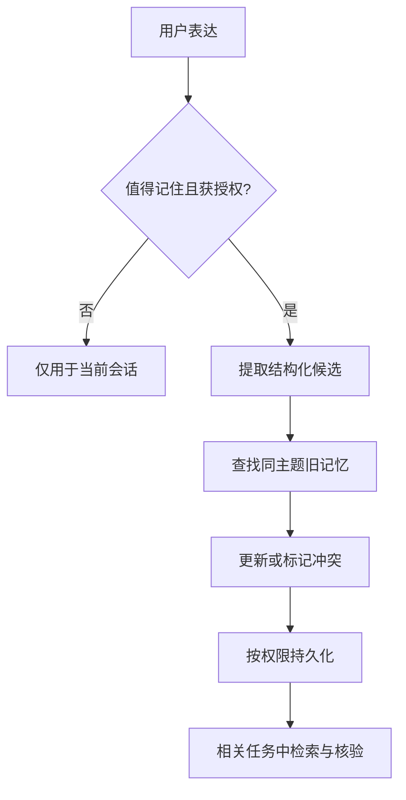

# 52. Agent 长期记忆：记住，也要会更新和删除

> **场景引入**：用户三年前喜欢甜咖啡，昨天说已经戒糖。若检索同时找出两条旧新偏好，却不判断有效时间，Agent 可能继续推荐甜饮。

> 对应[原始材料](../origanl/52-Agent%20长期记忆怎么做？让它记住三年前的用户信息.md)。

---

## 🎯 一句话定位

用户三年前说“喜欢甜咖啡”，昨天说“已经戒糖”。如果只把两句话存入向量库，检索可能同时取出它们。可靠记忆系统需要区分**事实、时间、来源、有效性和用户控制权**，而非只做相似度搜索。

---

## 💎 核心要点概览

| 记忆动作 | 必须核对 |
| --- | --- |
| 写入 | 是否有价值、是否获授权、来源是什么 |
| 更新 | 新话语是更正、临时状态还是长期变化 |
| 读取 | 时间、适用范围和当前任务 |
| 删除 | 用户更正与删除请求能否完整生效 |

---

## 🚀 核心总结

> **长期记忆不只是存得久，还要能判断新旧、接受更正并支持删除。**

---

## 一、三类状态

**会话上下文**维持当前对话连贯；**任务工作状态**记录已调用工具、待完成步骤和业务 ID；**长期记忆**保存经用户同意、跨会话有价值的信息。工作状态通常需要按任务持久化以便恢复，却不等于要永久保存为用户画像。

## 二、写入和读取规则

记忆条目可包含 `subject`、`predicate`、`value`、`source`、`observed_at`、`valid_from`、`valid_to`、`confidence`。用户明确纠正偏好时，应使旧条目失效或记录变更关系，而不是简单追加。对于过敏等高影响信息，不能仅按“越新越可信”排序；要核对用户原话、具体条件和是否有冲突，必要时再次确认。

检索可结合关键词、语义、时间和重要性，但最终应检查适用场景。例如“出差期间不喝咖啡”不应覆盖长期偏好。记录来源以便用户查看、更正、删除；设置保留期限和最小必要权限。敏感健康信息尤其需要严格控制，不能未经授权自动沉淀。

## 三、怎样评估记忆质量

准备跨时间、相互矛盾、用户撤回、同名实体和完全无关的对话样例，测记忆召回正确率、错误引用率、删除生效时间和隐私泄露风险。若记忆与当前用户指令冲突，以当前明确指令优先，并向用户说明不确定处。

**面试口述：**“长期记忆是带时间和来源的可更新事实库。写入前判断价值与授权，读取时结合相关性和有效期，冲突时不盲目选最新，支持用户更正与删除。”

**自检：**用户说“我最近不喝甜的”，系统应直接删除三年前所有饮食偏好吗？

---

## 四、落地 Checklist

- [ ] 每条长期事实附来源、时间、范围和当前状态。
- [ ] 临时偏好不会无条件覆盖长期偏好。
- [ ] 用户可查看、更正或删除保存的信息。
- [ ] 精确业务状态从权威系统查询。

## 五、总结（一句话带走）

> **可靠记忆是可治理的事实状态，不是越积越多的聊天文本。**
