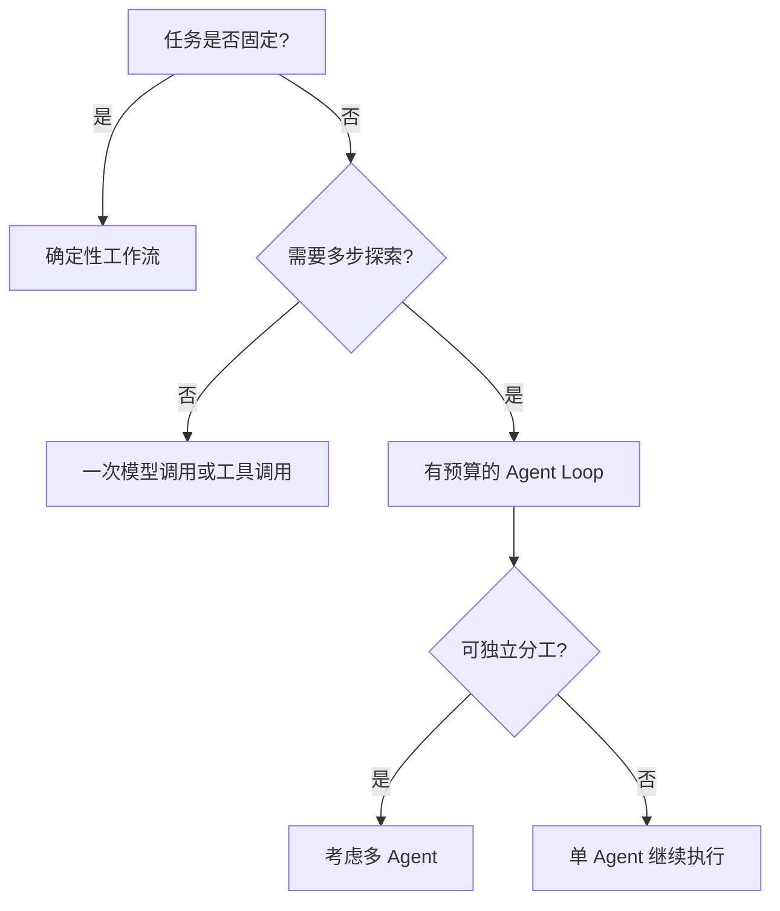

# 53. Agent 常见架构：按问题组合，而非背八个名字

> **场景引入**：固定三步审批流程，有人建议上多 Agent；项目真正需要的可能只是清楚的工作流和一处受控的文本提取节点。

> 对应[原始材料](../origanl/53-AI%20Agent%20八大主流架构，一次讲清怎么选.md)。原稿所列八项并非同一层级：有控制流程，也有工具、记忆和检索能力，实际项目常组合使用。

---

## 🎯 一句话定位

**谁决定下一步**：固定工作流、ReAct 循环、先规划后执行、多 Agent 协调。**从哪里获得事实**：工具、RAG、记忆。**怎样验证与纠错**：规则、测试、反思、人工。先回答这三问，比直接选一个“万能架构”更有效。

---

## 💎 核心要点概览

| 设计问题 | 常见选择 |
| --- | --- |
| 谁决定下一步 | 固定工作流、Agent Loop、规划执行 |
| 事实从哪来 | 工具、RAG、记忆 |
| 怎样验证 | 规则、测试、人工 |
| 要不要多 Agent | 任务可独立拆分且收益大于协调成本 |

---

## 🚀 核心总结

> **架构先按控制权、事实来源和验证方式拆解，再按任务组合。**

---

## 一、原稿八项怎样理解

| 名称 | 解决的问题 | 主要代价 |
| --- | --- | --- |
| ReAct | 每步观察后再决定动作 | 多轮延迟与成本 |
| Plan and Execute | 复杂任务先拆解再执行 | 计划可能过时，需动态修正 |
| Multi Agent | 独立角色协作 | 协调、冲突与权限成本 |
| Reflexive | 对结果增加复核 | 自评可能同错，需外部证据 |
| Tool Augmented | 访问实时数据或执行动作 | 工具质量与安全边界 |
| Memory Augmented | 保持跨轮或跨会话状态 | 冲突、隐私与过期治理 |
| RAG Agent | 查外部知识 | 检索质量与版本管理 |
| Autonomous Loop | 持续推进开放任务 | 失控风险，必须有预算与终止条件 |

例如售后客服可用固定路由处理常见问题，用 RAG 查规则、工具查订单；复杂争议再由有界 Agent Loop 调用多个工具，最后转人工。不需要先建立八套独立系统。原稿称某些方案“必然更准确”或“必然很慢”，均应在具体模型、任务和评测集上验证。

**面试口述：**“我先判断流程是否确定、是否需要实时工具、是否需要长时状态，再决定单次调用、工作流或 Agent Loop。多 Agent 只有在能力边界清晰且协作收益超过协调成本时才采用。”

**自检：**一个固定三步审批流程，是否一定需要多 Agent？

---

## 二、选型 Checklist

- [ ] 路径固定与否已识别。
- [ ] 实时工具、外部知识和记忆各有明确用途。
- [ ] 高风险步骤的权限与验证由程序掌握。
- [ ] 多 Agent 的协调成本与真实收益已比较。

## 三、总结（一句话带走）

> **先解决任务问题，再选择架构名称。**
