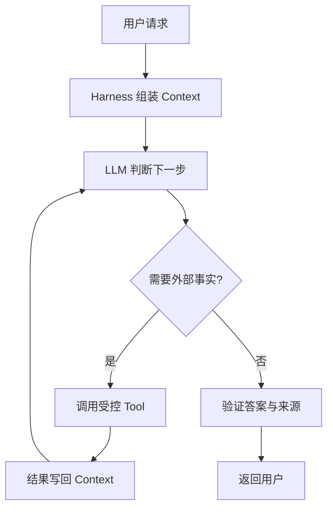

# 54. 从 LLM 到 Agent Loop，再到 Harness

> **场景引入**：用户问手机订单能否退款。模型不知道这笔订单的实时状态，也不能自己决定谁有权退款；应用必须提供数据、工具与执行边界。

> 对应[原始材料](../origanl/54-从大模型到%20Agent%20Loop，再到%20Harness：一条视频讲清全链路.md)。

---

## 🎯 一句话定位

**LLM 负责判断与生成，Agent Loop 负责多步反馈，Harness 负责上下文、工具、权限、验证与恢复。**

---

## 💎 核心要点概览

| 层 | 主要职责 |
| --- | --- |
| LLM | 根据输入提出下一步或答案 |
| Context | 提供当前目标与可信事实 |
| Tool | 查询或改变外部系统 |
| Agent Loop | 观察结果后继续、结束或求助 |
| Harness | 控制权限、预算、状态与验收 |

---

## 🚀 核心总结

> **从会回答到会办事，需要受控动作和真实反馈，不只是多调用几次模型。**

---

## 一、用退款问题串起全链路

用户问：“我的手机订单能退款吗？”模型本身没有这笔订单的状态，也未必知道当前企业规则。要给出可靠答案，应用需要提供任务指令、订单工具、规则资料，并在执行中验证结果。这条链路正好解释 LLM、Context、Tool、Agent Loop 与 Harness 的关系。

## 二、概念逐层理解

- **Token**：模型的输入输出计量单位。汉字与 token 没有固定比例，应以模型的 tokenizer 或 API 用量为准。
- **Prompt**：任务要求和指令；**Context**：这次请求模型能看到的全部内容，包括提示、对话、工具定义及结果。
- **Tool**：由应用提供的具体能力，如 `get_order`。模型提出调用，实际查询由应用或托管工具执行，业务权限仍在服务端校验。
- **MCP**：连接工具和数据的协议之一。一个普通函数也能是工具，不必为了使用工具强制引入 MCP。
- **Agent Loop**：模型根据结果继续决定是否调用下一步工具，直到达到目标或触发预算限制。
- **Skill**：把一类任务的步骤、知识或资源打包复用；具体实现因平台而异。
- **Harness**：管理上下文、工具、权限、验证和故障恢复的运行层。

## 三、设计这个售后 Agent

先让 `get_order` 返回签收时间、商品类型、订单状态，再检索生效中的退款规则。若缺订单号，先请用户提供；若规则与订单信息冲突，转人工。若用户只是问“能否退款”，不得直接发起退款。回复里说明结论来自哪个规则版本以及哪些订单事实。

**面试口述：**“LLM 负责判断与表达，Context 提供当轮事实，Tool 访问外部系统，Agent Loop 处理多步任务，Harness 约束并验证整个过程。业务权限与成功标准不交给模型自定。”

**自检：**模型生成了 `refund_order` 调用，是否意味着退款已发生？

---

## 四、落地 Checklist

- [ ] 当前订单与用户身份来自可信系统。
- [ ] 退款规则能引用现行条款。
- [ ] 写操作前校验权限、参数和确认。
- [ ] 完成状态来自工具实际结果并可追溯。

## 五、总结（一句话带走）

> **模型提出动作，Harness 管住动作，外部结果决定任务是否完成。**
