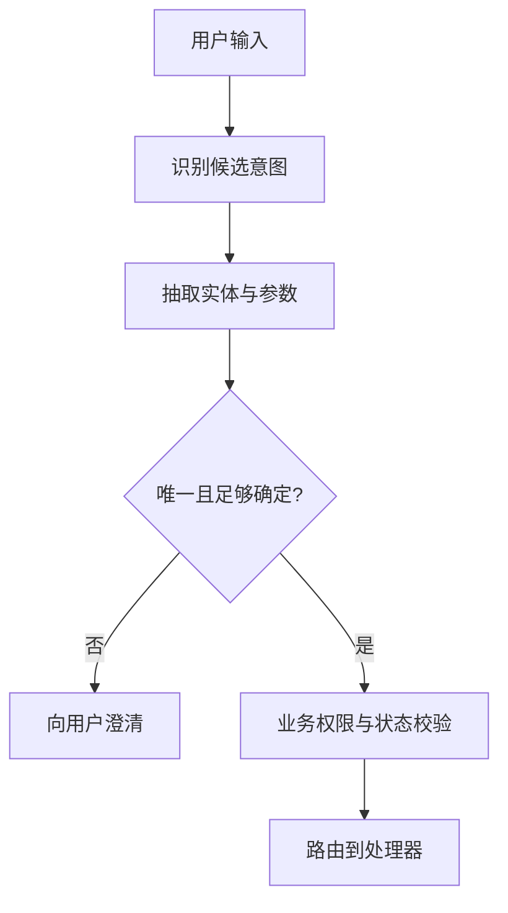

# 55. Agent 意图识别：从分类到安全路由

> **场景引入**：用户说“别帮我取消订单”。只看“取消”关键词就调用取消工具，会把否定句当执行指令。

> 对应[原始材料](../origanl/55-Agent%20意图识别怎么做？四种主流方案.md)。

---

## 🎯 一句话定位

**意图识别决定请求该去哪里；执行还需要唯一对象、完整参数、业务权限和状态校验。**

---

## 💎 核心要点概览

| 任务 | 关键检查 |
| --- | --- |
| 分类 | 是否真正要执行，否定和条件是否读对 |
| 抽参 | “第二个订单”等指代是否唯一 |
| 路由 | 规则、分类器、检索或模型哪个合适 |
| 执行 | 权限、订单状态和确认是否齐全 |

---

## 🚀 核心总结

> **识别正确只是入口；高风险动作要在执行层重新核对条件。**

---

## 一、先区分识别与执行

用户说“帮我取消第二个订单”。系统要先识别“取消订单”意图，再确定“第二个”是哪笔订单，最后检查权限与订单状态。识别正确并不等于可以直接执行。对于退款、删除等动作，参数缺失或指代不清时必须澄清。

## 二、四类常见方案

| 方案 | 适用场景 | 注意点 |
| --- | --- | --- |
| 规则或关键词 | 意图少、措辞稳定、强确定性 | 同义表达和上下文难覆盖 |
| 提示词分类 | 类别适中、需要理解自然语言 | 固定输出标签和置信处理 |
| 工具选择 / Function Calling | 意图与参数可直接映射工具 | 工具调用仍需业务校验 |
| 检索候选再判定 | 意图目录很大 | 候选召回错误会漏掉真意图 |

原稿把“RAG 分类”描述为大量类别的方案，但候选检索只解决缩小范围，最终要评估召回率。也不必一开始就用大模型：固定菜单、简单规则在高频低风险场景可能更稳更便宜。多意图句子还需拆分或按依赖排序，不能强行只归为一个标签。

## 三、怎样评估错路由

建立包含口语、省略、歧义、否定、跨轮改口和越权请求的标注集。测意图准确率、漏识别率、错误工具调用率和澄清率。高风险意图应优先降低误执行，而不是只追求分类准确率。

**面试口述：**“我先定义意图与业务处理器的边界，小类别可规则或提示分类，大目录可先检索候选，工具选择可同时产出参数。任何执行动作都要确认实体、权限与状态，并用真实语料测错路由率。”

**自检：**用户说“别帮我取消订单”，关键词命中‘取消’后直接路由会发生什么？

---

## 四、落地 Checklist

- [ ] 对否定、改口和歧义指代有测试样例。
- [ ] 参数不足时能够澄清，不强行猜测。
- [ ] 路由准确率与高风险误路由率分开统计。
- [ ] 执行层独立验证权限和当前业务状态。

## 五、总结（一句话带走）

> **先理解用户意图，再确认对象与授权，最后才执行。**
