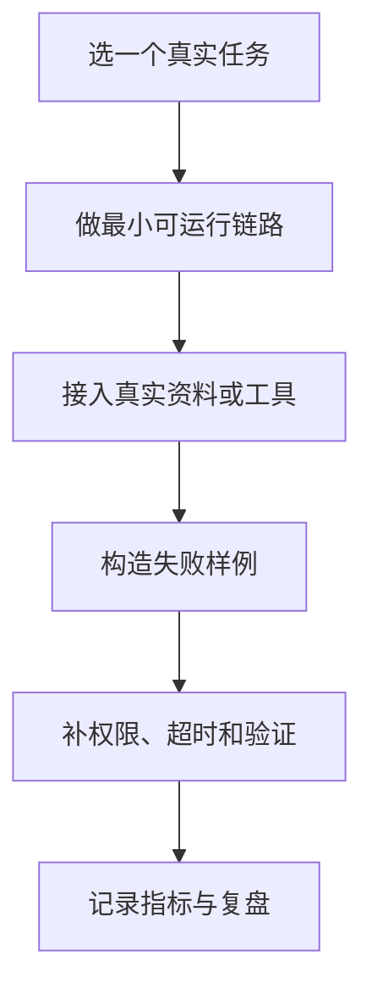

# 56. 学 Agent：用一个小项目跑通完整闭环

> **场景引入**：报销助手能检索制度，但工具报 500 时仍报出具体金额。学会接接口不等于学会处理失败。

> 对应[原始材料](../origanl/56-AI%20Agent%20怎么学进步最快？从零跑通一个完整项目.md)。原稿含课程推广；这里转成可独立执行的练习计划。

---

## 🎯 一句话定位

**用一个范围小、结果可检查的业务任务，依次练习模型、资料、工具、失败处理与评测。**

---

## 💎 核心要点概览

| 迭代 | 要验证什么 |
| --- | --- |
| 最小循环 | 模型何时调用工具、何时停止 |
| 资料接入 | 结论能否引用来源 |
| 异常处理 | 超时、500、空结果是否安全收尾 |
| 评测 | 成功和失败样例是否可回归 |

---

## 🚀 核心总结

> **进步来自完成并复盘一条任务链，而非累积互不相连的 Demo。**

---

## 一、先定一个小而真的任务

例如“根据内部文档回答报销问题，找不到依据就明确拒答”。它同时覆盖输入处理、检索、工具结果、错误处理与评估，却不需要先搭建复杂多 Agent 平台。学习目标不是写多少行代码，而是能解释每一步的输入、输出和失败方式。

## 二、四轮迭代

**第一轮：理解循环。**用模型 API 定义一个只读工具。模型请求工具时，应用执行并回传结果；模型不再请求工具时结束。加最大步数，打印每轮工具名、参数、结果摘要和耗时。不要把工具返回的内容当成新指令。

**第二轮：接业务事实。**让工具查询一份真实但脱敏的规则或测试数据库。加入参数校验、权限检查和找不到数据的路径。任何写操作先做模拟，不直接连接生产系统。

**第三轮：故意制造故障。**让工具超时、返回空值、返回相互冲突的规则；测试重复调用与错误引用。分别决定哪些情况重试、拒答或转人工。将这些样例保存成回归集。

**第四轮：再看框架。**当你确实遇到状态持久化、分支流程或人机交接的需求，再比较框架能节省的工作与带来的抽象成本。原稿说“必须先抛弃框架”过于绝对；学习底层循环有帮助，但项目选型取决于需求。

## 三、怎样证明自己学会了

能画出数据流，解释工具调用为何要回传结果；能复现至少三种失败并定位；能说明一次改动使哪项指标改善。项目 README 写清运行方法、边界、样例与评估，不以“调用成功一次”当完成。

**面试口述：**“我从一个有真实资料的小任务开始，先实现工具闭环，再补超时、权限、拒答和评测。框架是在理解状态与失败模式之后按需要选用的。”

**自检：**工具返回 500 错误，模型却生成了具体报销金额。你要在哪些层面修复？

---

## 四、实践 Checklist

- [ ] 有可运行的小项目和明确验收问题。
- [ ] 每轮增加一项能力并保存失败样例。
- [ ] 工具错误不会被模型掩盖为成功。
- [ ] 能解释每项技术为何加入和怎样验证。

## 五、总结（一句话带走）

> **从一个真实问题出发，逐步补齐数据、动作和验证。**
