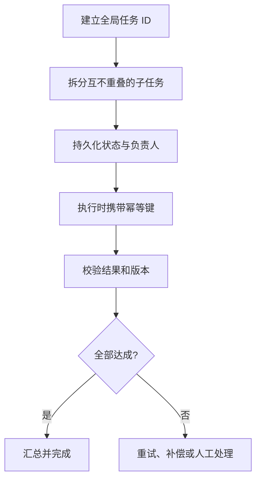

# 57. 多 Agent 并行：避免重复执行与结果冲突

> **场景引入**：两个 Agent 同时看到订单“待退款”，都发起退款；其中一次接口超时后又被重试。没有状态与幂等控制，就可能出现重复副作用。

> 对应[原始材料](../origanl/57-多%20Agent%20并行协作，如何避免结果打架？.md)。

---

## 🎯 一句话定位

**多 Agent 可以并行处理独立信息，但共享状态与外部写入必须受版本、幂等和业务规则约束。**

---

## 💎 核心要点概览

| 机制 | 防止什么 |
| --- | --- |
| 子任务边界 | 多个 Agent 重复做同一动作 |
| 幂等键 | 超时重试引起双执行 |
| 状态版本 | 旧结果覆盖新状态 |
| 补偿与接管 | 部分成功后无人收尾 |

---

## 🚀 核心总结

> **并行工作可以开放，实际业务写入要有唯一性与状态核验。**

---

## 一、先看冲突从哪里来

两个 Agent 同时看到“待退款”，都发出退款请求；或者调度服务超时重发，第一次请求其实已经成功。这里的核心是**外部副作用**与**状态一致性**，不是让模型在提示词里承诺“不要重复”。

## 二、四道控制

1. **任务边界**：每个子任务写明输入、输出与资源所有者。拆分时检查语义重叠；“查询账单”和“扣款”不能被两个角色同时当作自己的写任务。
2. **幂等与唯一约束**：外部写操作使用业务幂等键，服务端以唯一约束保存结果。Agent 重试可取回原结果，而不是再次扣费。
3. **并发控制**：共享对象带版本号。更新时使用条件写入，版本变化则重新读取和判断，不能让最后写入覆盖先前合法修改。
4. **恢复与补偿**：任务状态持久化，区分“未知是否成功”和“明确失败”。未知状态先查询下游。补偿是新的业务动作，可能失败，不能假设一定能完全回滚。

调度中心负责分配和跟踪，但单靠它不能保证一致性。消息可能重复送达、延迟或丢失；真正的安全边界要落在业务系统的状态机、幂等和权限校验上。异构 Agent 的结果需要统一 schema 并做语义校验，不能只拼接文本。

**面试口述：**“我先定义全局任务 ID、子任务职责和状态机；写操作携带幂等键，下游用唯一约束兜底；共享状态用版本控制。重试先查实际状态，无法自动修复的进入补偿或人工队列。”

**自检：**调用退款接口超时，但数据库已扣款。直接重试会有什么风险？

---

## 三、落地 Checklist

- [ ] 全局任务 ID 和子任务职责明确。
- [ ] 每个有副作用的动作有稳定幂等键。
- [ ] 共享状态提交有版本校验与审计。
- [ ] 超时后先查真实状态，再决定重试或人工处理。

## 四、总结（一句话带走）

> **多 Agent 的问题不在并行思考，而在重复写入和无依据的状态覆盖。**
