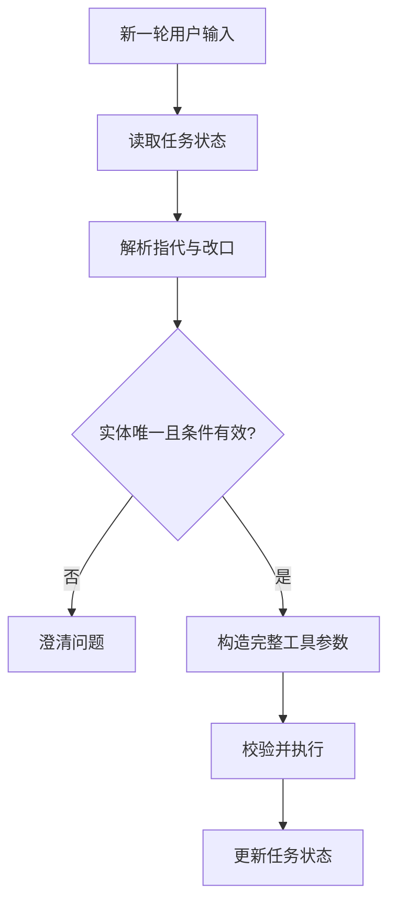

# 58. 多轮 Agent 为什么会忘记“当天”和“第二个”

> **场景引入**：用户先说周三到上海，再说“订当天的酒店”，最后说“把第二个取消”。若酒店列表已排序变化，“第二个”可能指向另一家。

> 对应[原始材料](../origanl/58-Agent%20聊了几轮就忘了上下文，怎么解决？.md)。

---

## 🎯 一句话定位

**多轮任务要保存可执行的结构化状态；聊天历史只帮助理解，不能代替稳定的实体 ID 与参数校验。**

---

## 💎 核心要点概览

| 要保存的内容 | 例子 |
| --- | --- |
| 当前目标 | 订酒店还是取消预订 |
| 已确认参数 | 城市、日期、预算 |
| 稳定对象 | 酒店 ID、订单 ID，不只记列表序号 |
| 执行状态 | 已查询、待确认、已提交 |

---

## 🚀 核心总结

> **用会话理解省略，用状态保存事实，用执行层确认对象。**

---

## 一、问题不只在 Prompt

用户先说“周三到上海”，再说“订当天的酒店”，最后说“把第二个取消”。系统要知道日期、城市和“第二个”对应的具体实体。把完整聊天记录反复塞进模型，可能帮助理解，却不能替代执行端的结构化任务状态与参数校验。

## 二、状态至少要记什么

保存当前任务 ID、已确认的日期与城市、候选车票/酒店的稳定 ID、用户选择、工具结果的时间戳与版本。对“第二个”不能仅保存列表序号：列表排序可能变化，需把该序号映射到当时展示给用户的实体 ID。用户把目的地改为广州后，依赖上海的酒店候选必须失效。

## 三、上下文与执行的分工

给模型的 Context 保留最近相关原话、当前结构化状态和必要工具证据。旧历史可摘要，但用户的否定、更正和关键数字要保留。工具调用前，应用检查必填字段、实体归属和状态有效期。不能确定时澄清，不能让模型猜订单号。

缓存只适合状态未变且资料仍有效的只读结果。例如车次查询可能随时间变动，不能只因为“还在同一任务”就永久复用。写操作结果应通过业务系统状态核验。

**面试口述：**“多轮对话需要结构化任务状态。模型负责理解省略和指代，执行端把它解析为稳定实体 ID，并检查是否与最新用户约束冲突；关键参数不确定就问，历史摘要只用于辅助。”

**自检：**酒店列表重新排序后，用户说‘取消第二个’，应直接按新列表下标执行吗？

---

## 四、落地 Checklist

- [ ] 指代解析绑定到稳定实体 ID，而非易变序号。
- [ ] 旧任务状态不会覆盖新用户指令。
- [ ] 关键参数不确定时先澄清。
- [ ] 写操作前再次确认目标对象与权限。

## 五、总结（一句话带走）

> **Agent 不该靠无限拉长聊天记录记事，任务状态要明确保存和更新。**
