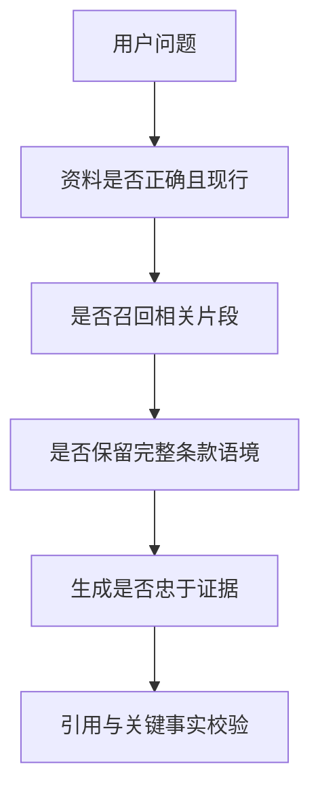

# 59. 接入 RAG 后仍会胡说：沿链路找原因

> **场景引入**：知识库同时有去年“15 天可退”和今年“7 天可退”。系统召回两份资料，却没核对生效日期，回答可能十分流畅但用错版本。

> 对应[原始材料](../origanl/59-接了%20RAG，为什么大模型还会胡说？.md)。

---

## 🎯 一句话定位

RAG 只是把检索到的资料放进生成过程，不能保证资料正确、版本正确，也不能保证模型忠实使用它。排障应把错误拆成**资料、召回、理解、生成、验证**五段，而不是一律归咎于“模型幻觉”。

---

## 💎 核心要点概览

| 排查层 | 常见错误 |
| --- | --- |
| 资料 | 旧版、错误 OCR 或缺来源 |
| 召回 | 正确条款没有进入候选 |
| 理解 | 条件、否定或例外被切断 |
| 生成 | 模型扩张证据范围或拼接冲突 |
| 验证 | 引用存在但不支持结论 |

---

## 🚀 核心总结

> **RAG 提供候选证据，答案可靠性还取决于资料治理与逐项核验。**

---

## 一、一个规则冲突例子

知识库同时有“去年退货期 15 天”和“今年退货期 7 天”。如果文档没有生效日期，检索只按相似度排序，模型可能引用旧政策。即便检索到新政策，若片段只截取“7 天”而丢掉“特定品类除外”，答案仍会错。提示词写“不要编造”无法修复源数据缺失。

## 二、分层治理

1. **资料层**：为文档标注版本、生效日期、适用地区、权限；清理重复与过期内容。
2. **检索层**：用真实问题评测召回；必要时混合关键词和语义检索，再重排。低分结果应允许拒答，不能硬凑几个片段。
3. **生成层**：让模型逐条回答，并标明对应证据；没有证据时说明无法判断。对长片段保留标题、条款前后文。
4. **验证层**：核对数字、金额、日期与引用是否一致；高风险结论交由规则系统或人工审核。另一个模型自审可以辅助，但不是独立真值来源。

## 三、评估要点

区分“检索没找到正确文档”和“找到了但答案说错”。前者优化资料与召回，后者优化上下文组织、提示与输出校验。每个错误保留问题、检索片段、文档版本和最终答案，才能复现。

**面试口述：**“RAG 降低信息缺口，但不是事实保证。我会按资料新鲜度、召回、片段完整性、生成忠实度和引用校验逐层定位，并用固定问题集测可答与应拒答场景。”

**自检：**答案引用了正确文件，却遗漏‘仅限未拆封’，算有依据吗？

---

## 四、落地 Checklist

- [ ] 文档版本、生效日期与适用范围可过滤。
- [ ] 条款条件、否定和例外没有被切片割裂。
- [ ] 答案的关键主张逐项有直接证据。
- [ ] 无证据时能拒答或澄清，不靠流畅表达填空。

## 五、总结（一句话带走）

> **先找证据在哪一步失真，再修那一步；“接了 RAG”不等于事实安全。**
