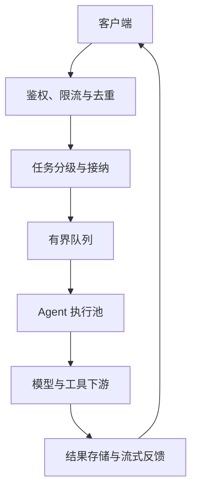

# 60. 大规模 Agent 服务：先算容量，再做分层

> **场景引入**：产品说“有百万用户”，但没有说明是注册量、在线连接数，还是每秒同时启动的 Agent 任务。三种数字对应完全不同的容量设计。

> 对应[原始材料](../origanl/60-百万用户同时聊%20Agent，系统怎么扛？.md)。原稿的“百万并发”没有明确是注册用户、在线连接还是同时执行的 Agent 任务；架构设计必须先澄清这些量。

---

## 🎯 一句话定位

Agent 一次请求可能触发多次模型和工具调用，系统承载能力由最慢、最昂贵的下游约束。先测每类任务的到达率、平均步骤数、token 用量、工具耗时和峰值，再按容量做接入限流、队列、执行池与降级。不能凭“百万用户”直接画出一套确定架构。

---

## 💎 核心要点概览

| 指标 | 用途 |
| --- | --- |
| 任务到达率 | 决定入口接纳与限流 |
| 每任务平均步骤和 token | 估算模型容量与费用 |
| 工具耗时与下游配额 | 确定执行池并发 |
| 队列等待与尾延迟 | 设计有界队列和降级 |

---

## 🚀 核心总结

> **先按真实任务负载算容量，再设计限流、队列、执行池和降级。**

---

## 一、四个关键设计

1. **入口**：按用户、租户和任务类型限流，限制单请求最大步骤。重复提交使用请求 ID 去重。鉴权失败不进入模型链路。
2. **队列**：队列缓冲短时峰值，但不能无限堆积。设容量、排队超时和拒绝策略；同步聊天请求不适合被悄悄排队很久，需告诉用户预计状态。
3. **执行**：按任务类型分池，设置模型调用和外部 API 的并发上限。只读缓存需考虑用户权限与数据时效；写操作不能因为“看起来相同”就复用结果。
4. **体验与降级**：流式展示真实进展；低风险问题可用轻量路径，高风险业务不能通过降低验证等级来提速。系统过载时应明确拒绝或转异步，而非编造答案。

## 二、用指标验证

压测至少报告请求到达率、排队时长、首字与完成延迟的 P95/P99、每任务模型调用次数、工具失败率、拒绝率和单位任务成本。用 Little 定律粗估在途任务数：平均到达率 × 平均停留时间；再结合峰值和尾延迟预留余量。消息队列只能搬移压力，不能创造下游算力。

**面试口述：**“先澄清百万指什么，再按任务步骤、token 和工具调用测容量。入口限流与去重，有界队列削峰，执行池按下游配额控制并发；降级保持业务正确性，用尾延迟、拒绝率和成本验证。”

**自检：**模型供应商限额每秒 100 次请求，而每个 Agent 任务平均调用 5 次，入口每秒接纳 100 个任务会怎样？

---

## 三、容量 Checklist

- [ ] 区分注册、在线、活跃任务与每秒到达率。
- [ ] 按任务类型记录步骤、token、工具耗时和峰值。
- [ ] 接纳速率不超过模型与工具的实际下游配额。
- [ ] 队列有上限，超载时明确拒绝或降级。

## 四、总结（一句话带走）

> **Agent 的并发由完整任务链的瓶颈决定，不由用户总数直接决定。**
