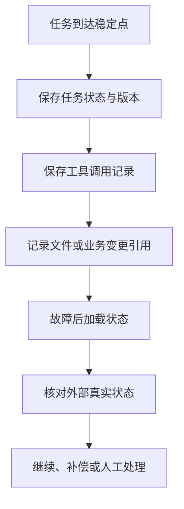

# 61. Agent Checkpoint：能恢复什么，不能恢复什么

> **场景引入**：Agent 发出付款请求后进程崩溃。重启加载上一份存档，不能直接重发付款；外部系统可能已扣款。

> 对应[原始材料](../origanl/61-3分钟讲透AI%20Agent存档机制.md)。原稿引用多个产品的内部存档细节，未逐项核验；这里讲通用设计。

---

## 🎯 一句话定位

Checkpoint 是“从某个稳定点继续运行”所需的状态记录，不等于聊天记录，也不等于把整个操作系统冻结。先明确要恢复的是**对话、任务进度、工作文件还是外部业务副作用**；不同层需要不同机制。

---

## 💎 核心要点概览

| 要恢复什么 | 应保存或核对什么 |
| --- | --- |
| 对话目标 | 当前目标、约束和已确认决定 |
| 任务进度 | 步骤状态、版本和工具调用 ID |
| 工作文件 | 提交、快照或变更记录 |
| 外部动作 | 向权威系统查询，再决定继续或补偿 |

---

## 🚀 核心总结

> **Checkpoint 保存可恢复的任务状态；外部世界的结果必须单独对账。**

---

## 一、应保存哪些信息

至少有任务 ID、目标、已完成步骤、待执行步骤、关键输入、工具调用 ID 和结果、模型及提示版本、时间戳。文件改动可以用 Git commit/diff、工作区快照或对象存储引用管理。外部支付、邮件发送等副作用不能靠恢复进程内存撤销，必须记录业务流水号并查询实际状态。

状态快照便于快速恢复，事件日志便于解释“为什么到这里”。二者可结合：定期快照，期间记录有序事件。重放事件时要区分纯计算与外部写操作，后者不能盲目重放。

## 二、例子：改代码时进程崩溃

恢复前先检查当前工作区文件、Git 状态和测试结果，再读取上次 checkpoint 的计划与工具记录。如果文件已经写成功但记录没落盘，直接重复写可能覆盖用户改动。使用文件版本或内容哈希检测差异；冲突时暂停交给人处理。

**面试口述：**“我把 Agent 状态、文件状态和外部业务状态分开。Checkpoint 保存任务进度与调用记录；恢复时先和真实环境对账，对写操作用幂等或补偿，不能把恢复对话等同于回滚世界。”

**自检：**Agent 已发出付款请求后崩溃，恢复时为什么不能直接重发？

---

## 三、恢复 Checklist

- [ ] 任务 ID、步骤版本和工具调用记录可追溯。
- [ ] 文件状态有提交或快照，不能只依赖聊天存档。
- [ ] 恢复前查询外部支付或审批的真实状态。
- [ ] 重试写操作有幂等键或人工接管路径。

## 四、总结（一句话带走）

> **存档能恢复 Agent 的进度，不能自动撤销或重现外部世界。**
