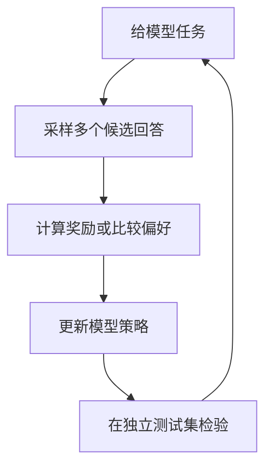

# 62. 为什么大模型训练会用强化学习

> **场景引入**：模型会模仿数学题答案，却未必能稳定解新题。若结果可验证，就能让它在多次尝试和反馈中调整策略；奖励设计不好也会学会投机。

> 对应[原始材料](../origanl/62-为什么大模型都在砸钱做强化学习？.md)。原稿的硬件规模和每小时费用未核验，不作为事实。参考 [DeepSeek-R1 论文](https://arxiv.org/abs/2501.12948)。

---

## 🎯 一句话定位

预训练让模型从海量文本中学习语言和知识；监督微调让模型模仿示例输出；强化学习则根据任务结果或偏好反馈，调整生成策略。可以把它理解成“先学会读写和解题样例，再用可检验的结果练习”。但 RL 不能凭空补齐缺失知识，奖励设计不良还可能让模型学会投机。

---

## 💎 核心要点概览

| 阶段 | 学习信号 |
| --- | --- |
| 预训练 | 大量文本中的语言与知识模式 |
| 监督微调 | 给定任务的示例答案 |
| 强化学习 | 结果奖励或偏好反馈 |
| 独立评测 | 是否泛化到未见过的任务 |

---

## 🚀 核心总结

> **强化学习用反馈优化策略，效果取决于奖励是否真正代表目标。**

---

## 一、为什么它有价值

数学、代码等任务往往能用答案、单元测试或规则提供相对明确的反馈。模型尝试不同推理路径，训练过程倾向提高得到好结果的路径概率。DeepSeek-R1-Zero 论文展示了在没有先做监督微调的特定设置下，通过大规模 RL 提升推理表现；这不意味着所有模型都只需 RL，也不意味着模型拥有人的自我意识。

## 二、为什么不能只看奖励

如果只奖励“通过公开测试”，模型可能针对测试分布优化，却在新题上失效。若奖励来自另一个模型，评判偏差也会传递。要同时看独立评测、可读性、安全性、成本和真实用户任务。原稿用“预训练装知识、RL 教思考”便于入门，但过于简化：预训练本身也能形成推理能力，RL 主要进一步塑造行为。

**面试口述：**“RL 利用结果或偏好反馈优化输出策略，尤其适合有可验证奖励的任务；它与预训练、监督微调相互补充。关键风险是奖励设计和泛化，必须用独立任务集检验。”

**自检：**模型只学会猜测公开单元测试，是否说明真实编程能力提高？

---

## 三、评估 Checklist

- [ ] 奖励与真实任务成功标准一致。
- [ ] 训练题和独立测试题严格分开。
- [ ] 检查是否出现投机、模式记忆或局部能力退化。
- [ ] 报告效果时注明模型、数据和评测条件。

## 四、总结（一句话带走）

> **奖励分数提高只是训练信号，真实能力要在独立任务上证明。**
