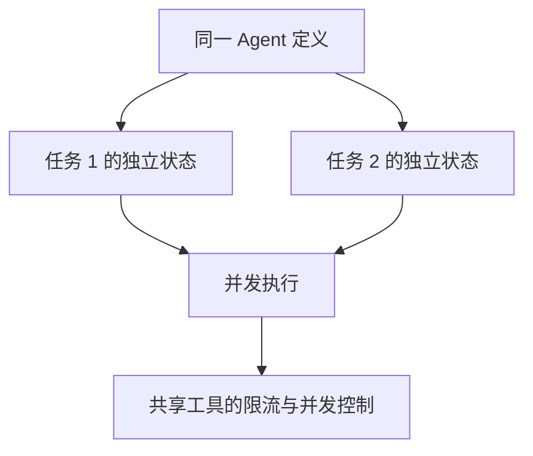

# 63. 一个 Agent 能同时处理多个任务吗？

> **场景引入**：两个用户共用一个全局 `messages` 数组。系统并发处理时，一人的订单信息可能串进另一人的回答。

> 对应[原始材料](../origanl/63-AI%20Agent能多任务并行吗？.md)。

---

## 🎯 一句话定位

“Agent”若指一套配置或代码，可以创建多个独立运行实例并发处理任务；若指同一个可变会话状态，直接让多个任务同时写它就可能串话。是否并行取决于**状态隔离、工具副作用、调度容量**，并不存在“默认一定只能串行”的通用规则。

---

## 💎 核心要点概览

| 并行类型 | 需要的边界 |
| --- | --- |
| 不同任务间 | 会话、权限、状态完全隔离 |
| 同一任务内 | 子步骤无依赖且无写冲突 |
| 共享工具 | 受数据库、模型和 API 配额限制 |

---

## 🚀 核心总结

> **Agent 定义可复用并发，运行状态不能无控制地共享写入。**

---

## 一、两种并行

**任务间并行**：两个用户的请求分别拥有会话 ID、上下文、工具调用记录和权限信息，可由不同 worker 执行。共享的只读工具可并发，但仍受数据库连接池和模型配额限制。

**任务内并行**：一个任务需要同时查天气与航班时，两个互不依赖的只读查询可以并发；若先付款再发票，或两个动作会修改同一订单，就必须按依赖与一致性要求排序。

最危险的实现是把“当前用户”“当前对话历史”等放在进程全局变量里。并发请求会互相覆盖。用任务 ID 隔离状态，工具调用携带租户与身份；共享资源使用锁、版本控制或业务幂等，而不是让模型自行协调。

**面试口述：**“一个 Agent 定义可以服务多个并发任务，前提是每个运行有独立上下文；同一状态的并发修改需协调。任务内部只并行无依赖、无冲突的动作，并按下游配额限流。”

**自检：**两个用户共用一个全局 `messages` 数组，最可能出现什么问题？

---

## 二、并发 Checklist

- [ ] 每个任务有独立会话 ID、上下文和权限信息。
- [ ] 任务内并行步骤没有未处理的数据依赖。
- [ ] 共享写入有版本、事务或其他并发控制。
- [ ] 工具并发受下游限额与安全策略限制。

## 三、总结（一句话带走）

> **并行能力来自状态隔离和依赖管理，不来自“多开几个模型调用”。**
