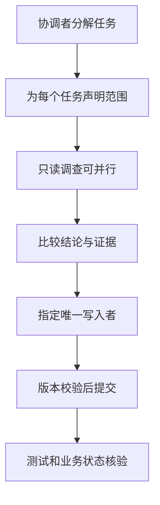

# 64. 多 Agent 冲突：意见分歧与写入冲突要分开

> **场景引入**：研究 Agent 认为应修改某模块，测试 Agent 发现模块已删除；另两个编码 Agent 又同时改同一文件。前者是证据分歧，后者是写入冲突。

> 对应[原始材料](../origanl/64-生产级Agent如何解决多智能体冲突？.md)。原稿的特定产品源码实现未核验；本文给出通用工程方法。

---

## 🎯 一句话定位

**先区分“结论不一致”与“共享资源被同时修改”；两类冲突需要不同处理。**

---

## 💎 核心要点概览

| 冲突 | 处理依据 |
| --- | --- |
| 事实或方案分歧 | 原始证据、版本、适用条件 |
| 文件或业务状态写入 | 所有权、版本校验、幂等 |
| 合并后的结果 | 集成测试与真实业务状态 |

---

## 🚀 核心总结

> **观点靠证据裁决，写入靠并发控制；两者都要验收最终结果。**

---

## 一、两类冲突

**结论冲突**：研究 Agent 认为应重构模块，测试 Agent 发现该模块已删除。需要比较证据与代码版本。**资源冲突**：两个编码 Agent 同时修改同一文件，或两个业务 Agent 同时更新同一订单。前者靠证据裁决，后者必须用写入权限和并发控制防止覆盖。

## 二、具体措施

给子任务明确目标、允许的文件或业务对象、工具权限、交付格式和完成标准。调研角色默认只读；写入由明确的所有者执行。文件修改可按文件所有权、独立 worktree 或补丁合并；合并时仍要检测冲突并运行测试。数据库对象用版本号条件更新、唯一约束与幂等键。

意见分歧不能简单“主 Agent 永远对”。要求双方提供可定位的证据：文件路径、提交版本、测试结果或原始资料。协调者基于证据决策；涉及不可逆动作或证据仍冲突时交由人处理。记录裁决原因，以便事后审计。

**面试口述：**“我先区分语义分歧和资源写冲突。语义问题对证据和版本，写冲突通过任务所有权、只读权限、乐观锁与幂等控制。最终用测试或业务状态验证结果。”

**自检：**两个 Agent 各自生成能通过单独测试的补丁，合并后还需要测什么？

---

## 三、落地 Checklist

- [ ] 子任务范围和唯一写入者明确。
- [ ] 事实分歧保留来源与版本，不靠多数票。
- [ ] 文件与业务状态提交经过版本检查。
- [ ] 合并后运行集成测试并核对业务结果。

## 四、总结（一句话带走）

> **多 Agent 冲突不是一种故障，先分型再处理。**
