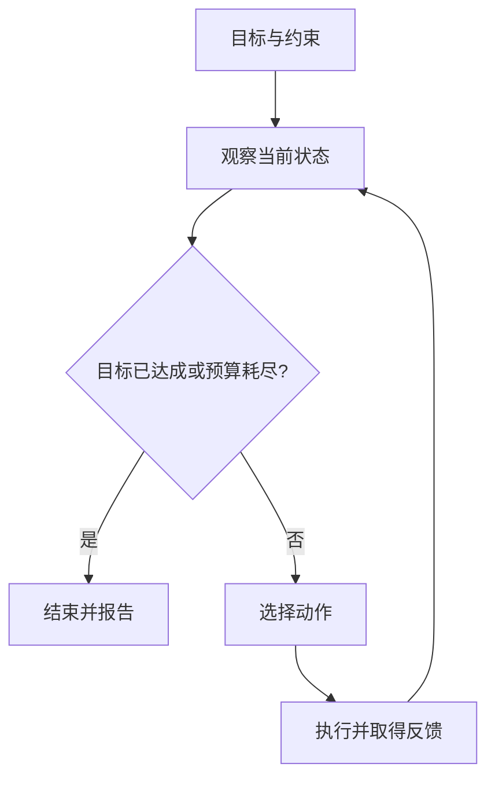

# 65. 最简单的 Agent：观察、决策、行动、再观察

> **场景引入**：扫地机器人发现障碍，转向后再次观察；若转向后不看结果，就不知道是否仍被挡住。Agent 的最小结构也是如此。

> 对应[原始材料](../origanl/65-字节AI面试：最简单的Agent闭环.md)。视频标题中的公司面试场景未核验，本文只讨论概念。

---

## 🎯 一句话定位

**有目标的 Agent 要能观察环境、选择动作、读取反馈，并判断继续还是结束。**

---

## 💎 核心要点概览

| 环节 | 关键问题 |
| --- | --- |
| 目标 | 完成什么，有哪些限制 |
| 观察 | 当前事实是什么 |
| 行动 | 执行哪个允许的动作 |
| 反馈 | 动作有没有改变状态 |
| 结束 | 何时成功、失败或预算耗尽 |

---

## 🚀 核心总结

> **Agent 不是单次回答，而是有反馈和终止条件的目标执行循环。**

---

## 一、最小闭环

一个 Agent 在目标约束下观察环境，决定下一步动作，执行后再观察变化，并判断是否继续。关键不在框架名，而在**动作是否带来新观察，以及系统怎样结束**。工具、记忆、规划可以增强这个闭环，但并非每个简单 Agent 都必须拥有全部能力。

## 二、一个不依赖大模型的例子

扫地机器人检测前方障碍，选择转向，转向后再次读取传感器。它符合观察、行动、反馈循环。反过来，一个固定的“接收问题→调用一次模型→直接返回”更像单次推理。是否称为 Agent 在行业里并无绝对统一边界；工程上更重要的是讲清系统是否能根据反馈调整下一步。

## 三、把闭环写成可靠程序

每轮记录目标、观察、动作、结果和耗时；定义最大步数与超时；动作前检查权限与参数；结束时用外部状态验证目标。对于不可逆动作，模型或策略只提出意图，业务系统负责审批与执行。没有停止条件的 while 循环是故障，不是自主性。

**面试口述：**“最小 Agent 是有目标的反馈循环：观察、决策、行动、再观察。工具和记忆是可选增强。工程实现还要有预算、终止条件、权限和完成验证。”

**自检：**执行一次工具后不看结果就宣布成功，闭环缺少哪一步？

---

## 四、实践 Checklist

- [ ] 每轮都有可观察的状态变化或错误信息。
- [ ] 工具执行权限由程序控制。
- [ ] 有步数、时间和费用上限。
- [ ] 最终完成声明有外部证据支持。

## 五、总结（一句话带走）

> **行动之后必须看反馈，才能谈下一步或完成。**
