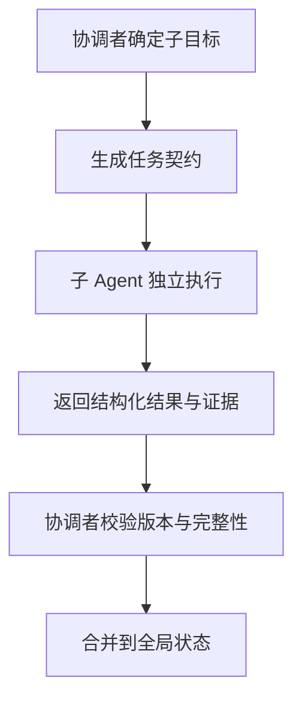

# 66. 多 Agent 交接：传任务契约，不传整段聊天

> **场景引入**：用户把目的地从上海改成广州，先前上海酒店子任务才返回。若协调者不核对目标版本，旧结果会污染新行程。

> 对应[原始材料](../origanl/66-多Agent协作：上下文与状态怎么传.md)。

---

## 🎯 一句话定位

协调 Agent 把任务交给分析 Agent 时，传太少会丢目标和约束，传全部历史会增加成本并暴露无关信息。交接应是一份**最小且可验证的任务契约**：目标、输入、权限、输出格式、完成条件和证据指针。

---

## 💎 核心要点概览

| 交接字段 | 用途 |
| --- | --- |
| 子目标与输入 | 说明具体要解决什么 |
| 权限与工具 | 限定能访问的资源 |
| 输出契约 | 让结果可验证、可合并 |
| 任务版本 | 阻止迟到结果覆盖新目标 |

---

## 🚀 核心总结

> **传递完成子任务所需的最小上下文，合并时再检查版本和证据。**

---

## 一、交接契约可以长什么样

例如“检查订单 123 是否符合退货规则”：输入是订单 ID 与已确认的用户身份；可用工具仅为只读订单查询和规则检索；输出字段为 `eligible`、`reason`、`rule_version`、`evidence`；禁止提交退货；查不到规则就返回 `unknown`。这样协调者能够区分“不符合”与“没查到”，也能核对依据。

## 二、状态怎样管理

全局状态保存任务 ID、原始用户目标、各子任务状态、证据与已执行的业务动作；子 Agent 只收到完成自己任务所需的切片。共享状态采用版本号或事件日志，避免迟到的旧结果覆盖用户新指令。交接时保留 trace ID 和来源，防止出现“结论正确却不知道来自哪份文档”。

原稿把主从拓扑视为默认最优，实际还要看任务依赖。简单工作流可直接调用函数；跨团队服务可用标准协议。无论拓扑如何，最小权限、结构化结果和版本校验都不可少。

**面试口述：**“多 Agent 交接我传目标、输入、权限、输出 schema、完成条件与证据引用，不传全量历史。全局状态集中记录任务和版本，迟到结果要检查是否仍适用。”

**自检：**用户把目的地改成广州后，先前上海酒店 Agent 的结果晚到，还能直接合并吗？

---

## 三、交接 Checklist

- [ ] 子任务有目标、输入、权限、输出与完成条件。
- [ ] 不把无关聊天和敏感资料整段传给子 Agent。
- [ ] 返回结果带任务版本和证据指针。
- [ ] 迟到结果在合并前检查是否仍适用。

## 四、总结（一句话带走）

> **多 Agent 协作的关键是可验证交接，不是复制完整对话。**
