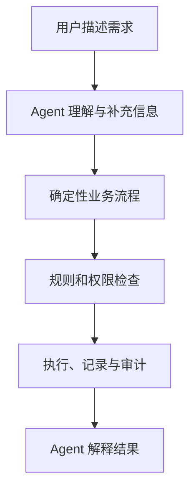

# 67. 通用 Agent 与企业自研：真正的分界在哪里

> **场景引入**：通用 Agent 能读发票和解释报销制度，却不能因“看起来符合规则”就绕过预算、审批和付款系统直接打款。

> 对应[原始材料](../origanl/67-通用Agent这么强，企业为何还要自研？.md)。原稿给出的准确率和故障数量只是举例，不能当实测数据。

---

## 🎯 一句话定位

企业是否自研，取决于业务流程、数据权限和可靠性要求。通用 Agent 可以做入口、问答和辅助分析；报销、退款、审批等关键动作需要由确定性的业务服务验证与提交。“自研”重点常在业务接口、状态机、权限、审计和评估，不必从零训练模型。

---

## 💎 核心要点概览

| 能力 | 通用 Agent 可做 | 企业系统必须保障 |
| --- | --- | --- |
| 理解请求 | 提取意图和缺失信息 | 身份与数据权限 |
| 解释规则 | 找资料并组织答复 | 现行规则与来源 |
| 执行报销 | 准备申请草稿 | 预算、审批、事务和审计 |

---

## 🚀 核心总结

> **企业自研的重点常是业务边界和执行系统，而非从零训练模型。**

---

## 一、用报销例子看边界

Agent 可以读发票、提示缺少项目编码、解释制度条款。但“是否超预算”“是否重复报销”“金额是否需要二级审批”应由业务服务根据当前数据库状态判断。即便工具描述写了所有规则，也不能将模型输出当作最终授权。调用失败时系统应保留任务状态，不能凭模型猜测报销已提交。

## 二、自研范围怎样决定

先试现有平台：是否满足数据驻留、身份透传、审计留痕、工具权限、人工审批与故障恢复？若都满足，集成可能比自研更省维护。若业务差异大、合规或可靠性要求高，需要掌握工作流和数据边界，则自研运行层或业务适配层更有价值。用项目总成本和真实评测结果比较，而不是“通用产品不可靠”或“自研一定安全”的口号。

**面试口述：**“我把自然语言理解交给模型，把业务规则和提交动作放在确定性服务。先评估通用平台是否满足身份、审计、审批和数据要求；缺口决定自研范围。”

**自检：**只让通用 Agent 通过 MCP 调用报销接口，是否足以保证预算校验不会被跳过？

---

## 三、选型 Checklist

- [ ] 通用平台满足身份、权限、审计和数据要求。
- [ ] 关键业务规则由确定性服务再次校验。
- [ ] 写操作状态、幂等和人工审批可控。
- [ ] 自研范围由实际缺口决定，而非宣传口号。

## 四、总结（一句话带走）

> **通用能力解决理解问题，企业系统负责可信执行。**
