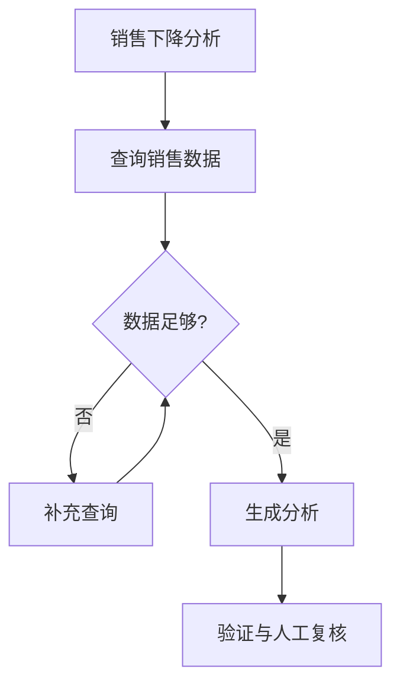

# 68. LangChain 与 LangGraph：看状态和流程需求

> **场景引入**：两步文档提取只需简单链路；“查数据 → 判断缺口 → 再查 → 等审批 → 恢复”则需要明确状态和分支。

> 对应[原始材料](../origanl/68-智能体框架怎么选？.md)。产品能力会更新，具体 API 与版本以 [LangChain 官方文档](https://docs.langchain.com/oss/python/langchain/overview) 和 [LangGraph 文档](https://docs.langchain.com/oss/python/langgraph/overview) 为准。

---

## 🎯 一句话定位

**框架选型看任务的状态、分支、恢复与人工介入需求，而不是看名字是否更“高级”。**

---

## 💎 核心要点概览

| 任务特点 | 优先考虑 |
| --- | --- |
| 短、固定、无恢复 | 直接调用或轻量组件组合 |
| 有循环、条件分支 | 显式状态与流程编排 |
| 需持久化和人工审批 | 可恢复的任务图与状态存储 |
| 所有方案共同点 | 权限与结果验证由应用负责 |

---

## 🚀 核心总结

> **先画任务状态图，再决定是否需要图式框架。**

---

## 一、先看任务结构

一个“输入文档→提取字段→格式化输出”的短链路，组件组合即可。一个“查数据→判断是否充分→必要时再查→人工审批→恢复执行”的流程，需要明确的状态、分支和持久化。框架选型取决于这些运行需求，而非谁名字更“高级”。

## 二、两者的侧重点

LangChain 提供模型、工具、检索等组件及 Agent 抽象，便于快速组合。LangGraph 更直接地表达有状态图：节点执行、边决定流向、状态跨节点传递，并支持持久化与中断相关机制。二者生态相关，不能简单说“LangChain 完全不能做循环”或“LangGraph 只用于多 Agent”。

## 三、选型步骤

先列出节点、状态字段、分支条件、重试与中断点，再做最小原型。检查：同一任务恢复时状态是否正确；工具写入是否可能重复；版本升级对代码的影响；trace 是否能定位失败节点。若固定工作流用普通代码就能清楚表达，也可不引入框架。

**面试口述：**“我从状态和控制流选型。简单组合可用 LangChain 或直接调用模型；有持久化、条件边、循环与人工介入时会评估 LangGraph。业务权限与结果验证仍在应用侧。”

**自检：**一条固定两步链路，没有恢复或分支需求，是否必须引入有状态图？

---

## 四、选型 Checklist

- [ ] 列出状态持久化、分支、恢复和审批需求。
- [ ] 用最小任务验证框架是否满足控制点。
- [ ] 检查工具调用前后的权限与结果校验位置。
- [ ] 比较开发、维护和故障排查成本。

## 五、总结（一句话带走）

> **简单任务别过度编排，复杂任务把状态与恢复写清。**
