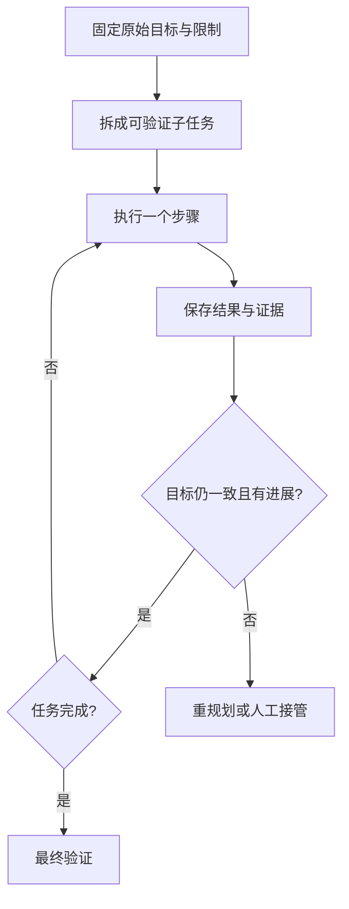

# 69. 长任务 Agent：如何防止跑偏和无限执行

> **场景引入**：Agent 原本要生成报告，却在反复检索和改写中忘记交付标准。它似乎一直忙，却没有向目标靠近。

> 对应[原始材料](../origanl/69-Agent长任务失控？五问搞定.md)。

---

## 🎯 一句话定位

长任务的难点是目标会被新观察、工具错误和冗长历史淹没。让任务持续可控，需要**目标锚定、分层计划、持久状态、进度检查和恢复边界**。提示词可以提醒模型，却不能代替代码层面的预算与权限控制。

---

## 💎 核心要点概览

| 五问 | 作用 |
| --- | --- |
| 目标是什么 | 锚定交付物和限制 |
| 下一步是什么 | 拆为可验证子任务 |
| 做到了哪步 | 持久化进度与证据 |
| 还在前进吗 | 识别伪进展和跑偏 |
| 何时停下 | 预算、完成条件与接管 |

---

## 🚀 核心总结

> **长任务靠目标锚定、状态记录和进展验收保持可控。**

---

## 一、五个问题逐一回答

1. **目标是什么？** 保存用户原话、交付物、禁止事项和完成标准。后续对话中的新要求要判断是补充还是改目标。
2. **步骤怎样拆？** 每个子任务有输入、输出、依赖与负责人；不要在没拿到数据时先写结论。
3. **进度怎样看？** 记录已完成步骤、证据和剩余工作。重复调用同一工具且状态不变应触发循环检测。
4. **失败怎样处理？** 临时故障有限重试；写操作先查询实际状态；计划不合适时只重规划未完成部分。
5. **何时停止？** 达到目标、预算耗尽、权限不足或连续无进展都应有明确终止路径。必要时转人工。

“回滚到上一个稳定节点”只适合可回滚的状态。文件可用版本管理恢复；已发出的邮件或支付不能靠恢复聊天撤销，需设计补偿与人工处理。用真实长任务评测完成率、步骤浪费、重复调用、人工接管率和成本。

**面试口述：**“长任务我固定目标和完成标准，结构化记录每步进展，按依赖执行并设置步数、时间和成本预算。失败时区分重试、重规划和补偿；结束以外部证据为准。”

**自检：**Agent 已经发出邮件后回滚 checkpoint，邮件会自动消失吗？

---

## 二、长任务 Checklist

- [ ] 用户目标、限制和完成标准持久保存。
- [ ] 每步有可观察产出和证据。
- [ ] 轮数、时间和费用预算明确。
- [ ] 失败区分重试、重规划、补偿与人工接管。

## 三、总结（一句话带走）

> **长任务不能靠模型一直“想下去”，每一步都要有进展证据和停止条件。**
