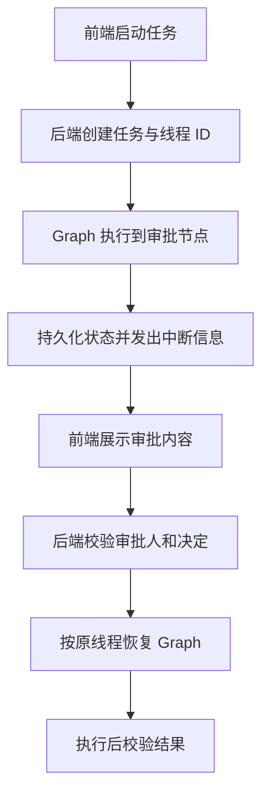

# 70. LangGraph 中断：把人工审批接入可恢复任务

> **场景引入**：Agent 准备提交退款申请，必须等人工审批。等待一小时后订单可能已变化，因此恢复执行时不能直接沿用旧状态。

> 对应[原始材料](../origanl/70-LangGraph中断机制怎么设计.md)。以下按 [LangGraph 官方文档](https://docs.langchain.com/oss/python/langgraph/interrupts) 理解中断与恢复；具体 API 随版本变化。

---

## 🎯 一句话定位

**中断是把流程停在可恢复状态，等待经过认证的外部决定；恢复后仍要校验最新业务事实。**

---

## 💎 核心要点概览

| 组件 | 职责 |
| --- | --- |
| Graph | 到达审批节点并保存状态 |
| 后端 | 绑定任务与身份、鉴权审批决定 |
| 前端 | 展示具体动作与影响 |
| 业务接口 | 恢复后重新校验并幂等执行 |

---

## 🚀 核心总结

> **可恢复的审批需要状态存储、身份校验和恢复后的再次验证。**

---

## 一、用退款审批看中断流程

Agent 已准备好退款申请，但提交前需要人工审批。中断不是“前端弹窗”本身，而是运行到审批点时保存可恢复状态，等待一个经过认证的决定，再从对应任务继续。前端、后端和 Agent 运行时各有职责。

## 二、关键实现点

Graph 需要 checkpointer 保存状态，并用稳定的任务/线程标识关联恢复请求。中断时返回给前端的应是可审查内容：操作类型、目标、金额、依据、过期时间。审批结果由后端校验身份、权限和是否重复提交，不能信任前端传来的“approved=true”。恢复时要带回正确线程和决定，拒绝分支也要明确处理。

尤其注意：中断点恢复可能导致节点中断前的逻辑重新执行。中断前若已调用外部写接口，可能产生重复副作用；应把写操作放在审批后的安全节点，并使用幂等键。审批期间数据可能变化，恢复执行前重新校验订单状态和规则版本。

**面试口述：**“中断是持久化状态加等待外部输入。前端展示审批，后端鉴权并提交决定，Graph 用对应线程恢复。审批后再做业务校验和幂等写入，避免恢复重跑带来重复动作。”

**自检：**审批等待一小时后订单状态已变化，能直接执行原计划吗？

---

## 三、落地 Checklist

- [ ] 中断点有持久任务/线程 ID 与待审批参数。
- [ ] 审批者身份与权限由后端核对。
- [ ] 恢复时重查订单状态与规则版本。
- [ ] 最终写操作幂等且可审计。

## 四、总结（一句话带走）

> **中断解决“等人”，恢复后的业务校验解决“还能不能做”。**
