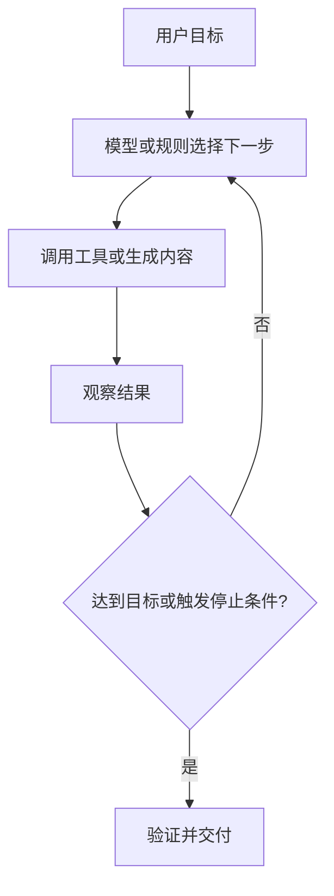

# 71. Agent、LLM 与 Workflow：按控制权区分

> **场景引入**：一条发票流程固定为“OCR → 校验 → 入库”，其中 OCR 使用模型。这不代表整套系统会根据反馈自主选择路径。

> 对应[原始材料](../origanl/71-别再说Agent是大模型加工具了.md)。

---

## 🎯 一句话定位

LLM 是生成与决策能力；工具让应用接触外部世界；Agent 是围绕目标运行、能根据反馈调整下一步的系统；Workflow 则主要由程序预先规定步骤。它们不是互斥关系：一个工作流可以包含模型节点，一个 Agent 也可以运行在有边界的工作流里。

---

## 💎 核心要点概览

| 概念 | 谁决定下一步 |
| --- | --- |
| LLM | 提供生成或候选判断 |
| Tool | 由应用执行外部动作 |
| Workflow | 程序规定路径与分支 |
| Agent | 在边界内根据反馈调整动作 |

---

## 🚀 核心总结

> **判断是否是 Agent，要看它是否在目标约束下用反馈决定下一步。**

---

## 一、用发票流程作对照

“收到发票→OCR→按固定规则校验→写入系统”是典型 Workflow，步骤预设。若系统在资料不足时自己决定补查订单、询问用户或调用另一数据源，则具有更明显的 Agent 特征。单次模型函数调用也可能足够完成业务，没必要为名称争论而增加循环。

原稿称“只调用一次工具绝不算 Agent”，属于人为划界；不同团队用法不同。工程上更可检验的指标是：控制流由谁决定、状态如何保存、失败怎样处理、何时停止、是否有外部完成证据。动态循环带来灵活性，也让成本和风险难预测，因此须设置预算和权限。

**面试口述：**“LLM 是推理组件，Agent 是有目标、状态、工具和反馈的运行系统；Workflow 的主要控制流预先确定。项目里我先用可控流程解决确定任务，只在路径需要根据观察动态变化时引入 Agent 决策。”

**自检：**模型每次都只负责把发票字段转 JSON，流程路线固定，这更像哪一种系统？

---

## 二、辨别 Checklist

- [ ] 流程路径与分支由谁决定已说明。
- [ ] 工具调用之后会读取结果并决定后续动作。
- [ ] 动态决策有权限、预算和停止条件。

## 三、总结（一句话带走）

> **模型加工具可以是工作流节点；Agent 的关键是有反馈的目标执行。**
