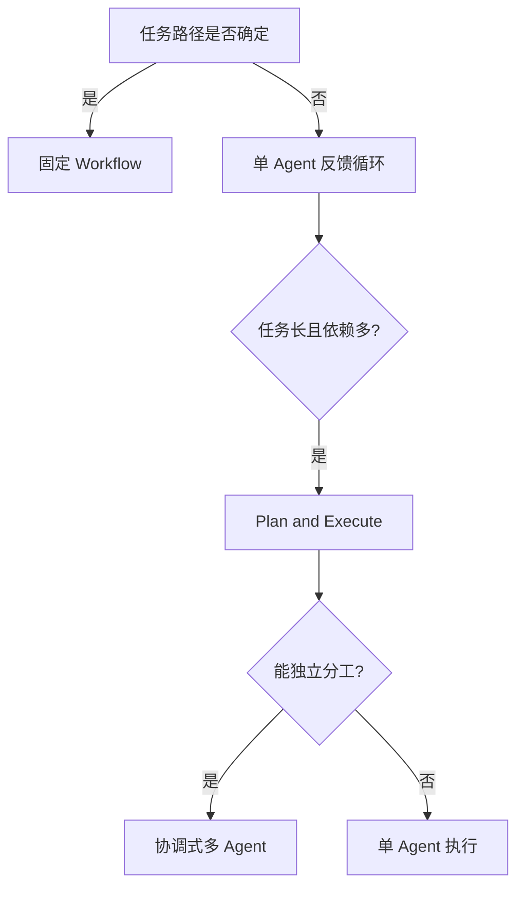

# 72. 七类 Agent 设计模式怎样选

> **场景引入**：一个固定两步问答流程，有人建议使用黑板式多 Agent。分工、通信与合并成本可能远大于任务本身。

> 对应[原始材料](../origanl/72-一次性讲透7种主流Agent架构.md)。原稿的七类跨越控制流、能力组合与通信方式，不是严格互斥的分类。

---

## 🎯 一句话定位

**先决定路径由规则还是模型控制，再按事实来源和协作需要添加工具、检索或多 Agent。**

---

## 💎 核心要点概览

| 任务特点 | 起步方案 |
| --- | --- |
| 路径固定 | 工作流 |
| 需要按反馈探索 | 有预算的 Agent Loop |
| 长任务依赖多 | 规划与执行、必要时重规划 |
| 可独立拆分 | 比较多 Agent 收益与协调成本 |

---

## 🚀 核心总结

> **所谓“七种模式”不是互斥菜单，真实架构常按任务组合。**

---

## 一、先看控制流，再看配套能力

从固定流程开始，若任务需要根据结果调整，再考虑循环或规划；若能拆成相互独立的专业子任务，再考虑多 Agent。检索、工具和 Skill 常是附加能力，不必先在七个标签中“选唯一一个”。

| 原稿名称 | 主要用途 | 需要额外注意 |
| --- | --- | --- |
| Single Agent | 小任务的单一决策者 | 明确停止条件 |
| ReAct | 边观察边行动 | 控制步骤与费用 |
| Plan and Execute | 长任务先拆后做 | 允许重新规划 |
| Multi Agent | 分工并行 | 交接、权限、冲突 |
| Router + Skill | 按意图选能力 | 错路由和能力边界 |
| Blackboard | 共享工作状态 | 版本、并发写入 |
| Graph Workflow | 显式状态与分支 | 持久化和恢复 |

原稿认为 Router + Skill 是某些领域“最佳实践”，但需要基于问题集验证。复杂任务路由不准时，后面的 Skill 再好也无用；共享黑板若缺版本控制，会造成旧状态覆盖。架构比较要看正确率、延迟、成本、失败恢复和开发维护难度。

**面试口述：**“我先判断流程确定性和任务依赖，再选固定流程、反馈循环或规划执行。工具、检索与 Skill 按需加入；多 Agent 只有在分工收益大于协作成本时使用。”

**自检：**一个两步固定问答流程，使用黑板式多 Agent 会增加哪些负担？

---

## 二、选型 Checklist

- [ ] 固定流程是否已经足够。
- [ ] 动态循环有终止与预算边界。
- [ ] 工具、检索、Skill 各有明确任务。
- [ ] 多 Agent 的协调开销已有实测。

## 三、总结（一句话带走）

> **复杂架构只有解决真实问题时才值得加入。**
