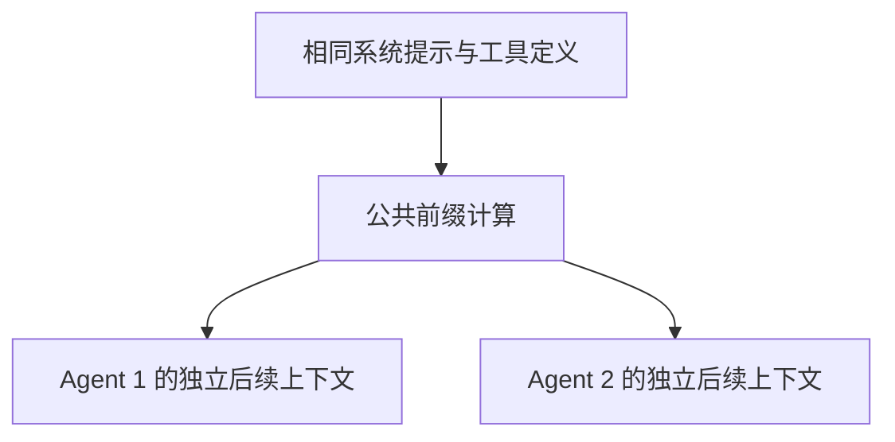

# 73. 多 Agent 可以共享 KV Cache 吗？

> **场景引入**：两个 Agent 使用相同的系统说明和工具定义，却分别处理不同用户请求。共同前缀可能复用计算，用户部分仍需独立处理。

> 对应[原始材料](../origanl/73-多Agent能共享KV%20Cache吗.md)。不同推理引擎的缓存实现不同；不要把某一种 radix tree 设计当成统一协议。

---

## 🎯 一句话定位

多个 Agent 运行实例的生成状态彼此独立，但如果推理服务支持**前缀缓存**，它们相同的输入前缀可能复用已计算的 KV 中间结果。共享的是符合条件的前缀计算，后续各自的用户消息和生成内容仍要分别处理。是否命中取决于服务端实现、前缀 token、模型版本和缓存生命周期。

---

## 💎 核心要点概览

| 类型 | 复用什么 | 注意点 |
| --- | --- | --- |
| KV 前缀缓存 | 相同 token 前缀的计算 | 后续上下文仍各自推理 |
| 语义结果缓存 | 已生成答案 | 权限、版本和业务对象必须一致 |
| 会话状态 | 各 Agent 自有任务进度 | 不能因前缀相同而共享私有状态 |

---

## 🚀 核心总结

> **可共享的是符合条件的计算前缀，不是整段会话与答案。**

---

## 一、与语义缓存分开看

前缀缓存是推理计算层面的复用，要求精确前缀匹配。语义缓存是在应用层把相似问题映射到已有答案，可能完全跳过模型，但答案是否适用于当前用户、时间和权限需要额外判断。原稿把“语义缓存是否命中”列为 KV 共享条件，这是概念混淆。

## 二、实际优化

把跨 Agent 共用且稳定的系统说明与工具 schema 放在前部，动态用户数据后置；记录缓存命中 token、首字延迟和总费用。不同 Agent 若权限不同，不能为了凑相同前缀而省略权限上下文；缓存复用必须由推理服务保证隔离，应用不能直接把一个用户的 KV 状态交给另一个用户。

**面试口述：**“默认生成状态按请求隔离；支持前缀缓存的推理服务可复用相同开头的 KV 计算。语义缓存复用答案，是另一层机制。实际收益与安全性看服务实现和监控数据。”

**自检：**两个 Agent 的用户数据不同，但系统提示相同，哪些部分可能复用？

---

## 三、缓存 Checklist

- [ ] 模型版本与 token 前缀一致性已确认。
- [ ] 用户私有内容不当作公共前缀复用。
- [ ] 结果缓存另做权限、时效与版本校验。
- [ ] 收益以实际命中量和任务成本衡量。

## 四、总结（一句话带走）

> **多 Agent 可以共享部分前缀计算，但不能共享彼此的业务结论。**
