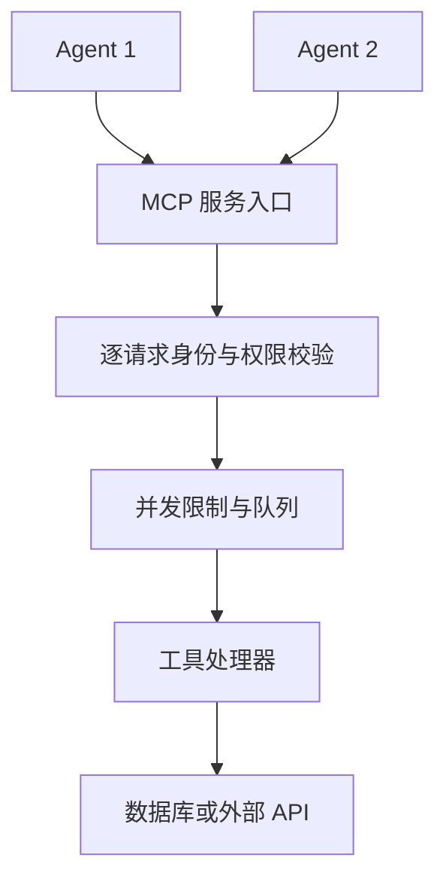

# 74. 多 Agent 并发调用 MCP 服务

> **场景引入**：HTTP MCP 服务能同时接 100 个连接，不代表背后的数据库写工具能安全处理 100 笔并发修改。

> 对应[原始材料](../origanl/74-多智能体如何并发调用MCP服务？.md)。原稿称“一个 MCP Server 默认同一时刻只能服务一个 Agent”，与协议和多种 SDK 实现不符。参考 [MCP 官方 SDK 的传输说明](https://csharp.sdk.modelcontextprotocol.io/v2/concepts/transports/transports.html)。

---

## 🎯 一句话定位

MCP 定义客户端与服务器交换工具、资源等能力的方式，**并不规定一个服务实例只能连接一个 Agent**。能承受多少并发，取决于传输方式、服务实现、会话管理、下游资源和配额。真正要设计的是每个请求的身份隔离、共享资源并发控制以及过载处理。

---

## 💎 核心要点概览

| 层次 | 并发约束 |
| --- | --- |
| 连接与传输 | 服务实现、线程与连接限制 |
| 会话与身份 | 每个请求的授权和上下文隔离 |
| 下游工具 | 数据库、API 配额与写入冲突 |
| 过载处理 | 限流、排队、超时和扩容 |

---

## 🚀 核心总结

> **MCP 不是“单 Agent 专用”协议，并发能力取决于服务与下游的真实瓶颈。**

---

## 一、三种常见部署

本地 `stdio` 传输常由客户端启动子进程，每个进程的会话由进程生命周期约束。远程 HTTP 服务可处理多个客户端请求；无状态请求易于横向扩展，有状态会话则需管理会话 ID、生命周期与路由。网关和连接池是某些负载下的优化方案，不是 MCP 并发的前提。

## 二、最容易出错的地方

不要把认证信息放在进程全局变量里，导致 A 的 token 被 B 的请求复用。每次工具调用都要从可信请求上下文取得用户、租户和权限；后端仍需对目标资源鉴权。工具若写共享数据，应使用幂等键、事务或版本控制。压测时看每工具 P95/P99 延迟、连接数、排队长度、下游限额与错误率。

**面试口述：**“多个 Agent 可以并发访问同一个 MCP 服务。并发能力由服务实现与下游容量决定；我按请求隔离身份和会话，对写工具做幂等与并发控制，再按压测结果考虑网关或扩容。”

**自检：**HTTP MCP 服务能处理 100 个连接，是否代表数据库写工具也能安全并发 100 次？

---

## 三、并发 Checklist

- [ ] 请求身份与租户上下文隔离。
- [ ] 写操作有幂等和并发控制。
- [ ] 按下游配额设置限流与有界队列。
- [ ] 用压测确认真实吞吐和尾延迟。

## 四、总结（一句话带走）

> **连接数不是安全吞吐量，容量要测到工具和数据库。**
