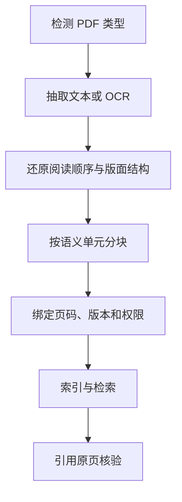

# 75. PDF 进 RAG：先保留结构，再做检索

> **场景引入**：扫描合同里的“不得退款”被 OCR 误读为“得退款”。如果入口文字就错了，后续向量检索再准也可能给出反结论。

> 对应[原始材料](../origanl/75-PDF文件识别RAG应该怎么处理？.md)。

---

## 🎯 一句话定位

PDF 是版面格式，不等于干净的连续文本。纯文本 PDF、扫描件和图文混排文件的抽取方式不同；关键是把**段落、标题、表格、页码和来源**保留下来。直接抽全文再按固定字数切块，可能把表格列顺序和合同条款条件弄乱。

---

## 💎 核心要点概览

| PDF 类型 | 处理重点 |
| --- | --- |
| 可选中文本 | 阅读顺序、坐标与页眉页脚 |
| 扫描件 | OCR、低可信字符和人工抽检 |
| 图文混排 | 按页选择解析方式，保留表格结构 |
| 所有类型 | 页码、版本、权限和原页引用 |

---

## 🚀 核心总结

> **PDF 入库前先验证文字与版面是否真实保留，再切片和检索。**

---

## 一、分类型处理

**可选中文本**：读取文字和坐标，检查双栏顺序、页眉页脚重复。**扫描页**：先 OCR，保留置信度与原页图；低置信结果需人工校对。**表格/图表**：保留行列关系、单位、表头和脚注；图表可附结构化说明，但生成的说明不能替代原图作为证据。

## 二、分块与索引

优先按标题、条款、段落和表格边界切；长章节再细分。每个片段带文档 ID、版本、页码、章节、坐标、权限标签。检索时先按权限和生效版本过滤，再做关键词/语义召回与重排。回答中的引用应能打开原页，用户可检查是否遗漏“仅限”“除外”等限制词。

## 三、质量检查

抽样核对 OCR 字符错误、阅读顺序、跨页表格、金额单位和脚注关联。建立真实问题评测集，把“检索命中正确页”和“回答忠于原文”分开统计。高风险合同或财务结论需要专业人员审核；视觉模型给出的解释也可能误读。

**面试口述：**“PDF 先分类，分别做文字抽取、OCR 和版面还原。按结构分块并保存页码与版本；检索后回到原页校验表格和限制条件，分别评估抽取、召回和回答质量。”

**自检：**扫描合同 OCR 把“不得”识别为“得”，只靠向量检索能发现吗？

---

## 四、解析 Checklist

- [ ] 混合 PDF 按页判断是否需要 OCR。
- [ ] 表格行列、条款条件与否定词有抽样核对。
- [ ] 切片能回到具体页码和原文位置。
- [ ] 低可信关键字段不会被自动当作事实。

## 五、总结（一句话带走）

> **解析质量决定 RAG 能否得到正确证据。**
