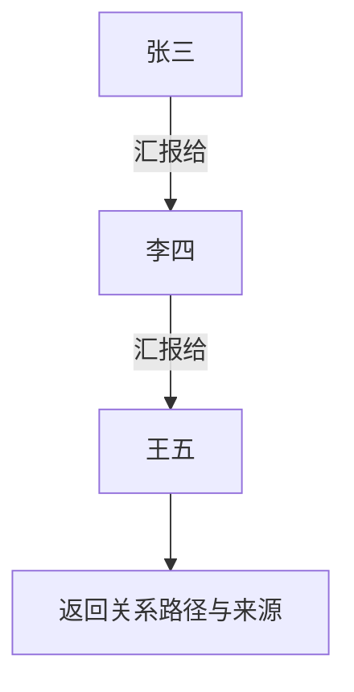

# 76. 跨文档关系问题：何时考虑 Graph RAG

> **场景引入**：文档 A 写张三向李四汇报，文档 B 写李四向王五汇报。问“张三的上上级是谁”，需要跨两份文档连成一条关系路径。

> 对应[原始材料](../origanl/76-PDF文件识别RAG应该怎么处理？（重发）.md)。原稿标题沿用“PDF 识别”，正文实际讨论跨文档多跳关系检索；本文按正文主题整理。

---

## 🎯 一句话定位

**当问题依赖可重复查询的跨文档实体关系时，可以评估 Graph RAG；建图前先验证普通检索是否足够。**

---

## 💎 核心要点概览

| 环节 | 关键问题 |
| --- | --- |
| 实体抽取 | “张工”和“张三”是否同一人 |
| 关系入图 | 方向、时间和来源是否正确 |
| 路径查询 | 多跳关系是否满足当前组织版本 |
| 回答核验 | 每条边能否回到原文 |

---

## 🚀 核心总结

> **图结构让关系显式可查，也把实体消歧和版本维护变成必做工程。**

---

## 一、问题长什么样

文档 A 说张三向李四汇报，文档 B 说李四向王五汇报。用户问“张三的上上级是谁？”普通检索可能找到其中一段，却不一定把两条关系连起来。图结构可以把“人—汇报给—人”的关系显式保存，按路径查询并回到原始文档核对。

## 二、Graph RAG 的代价

先抽取实体和关系，再做同名消歧、别名合并、版本更新与权限控制。若把“张工”错误合并到另一个张三，图上的路径看似完整但结论全错。每条边必须绑定来源文档、时间和可信度；组织架构变动时要使旧边失效。

检索策略可分流：查单条规则用普通关键词/向量检索；明确的关系链问题查图；跨主题归纳可结合两者。原稿说普通 RAG “无法”多跳推理过于绝对：若所需片段被正确召回并保留语境，模型也可能推理成功。图谱的价值在于关系可显式查询与审计，但不保证抽取正确。

## 三、怎样验证值得建图

收集真实多跳问题，比较基线 RAG、增加查询改写/迭代检索、显式图谱三种方案的正确率、可追溯性、维护成本与延迟。若多跳问题很少或关系频繁变化，先改进检索可能更合算。

**面试口述：**“跨文档多跳问题可用带来源的关系图查询，但先验证普通检索是否足够。建图的难点是实体对齐、关系质量、权限和增量更新，不能只演示一条正确路径。”

**自检：**组织架构变更后，旧的“李四汇报给王五”边还在，会造成什么错误？

---

## 四、建图 Checklist

- [ ] 多跳问题在普通检索下确实表现不佳。
- [ ] 实体别名、同名和跨版本关系可治理。
- [ ] 每条边保留来源、时间和权限信息。
- [ ] 用真实问题比较建图前后的收益与维护成本。

## 五、总结（一句话带走）

> **Graph RAG 适合关系密集的问题，但图的每条边都要经得起追溯。**
