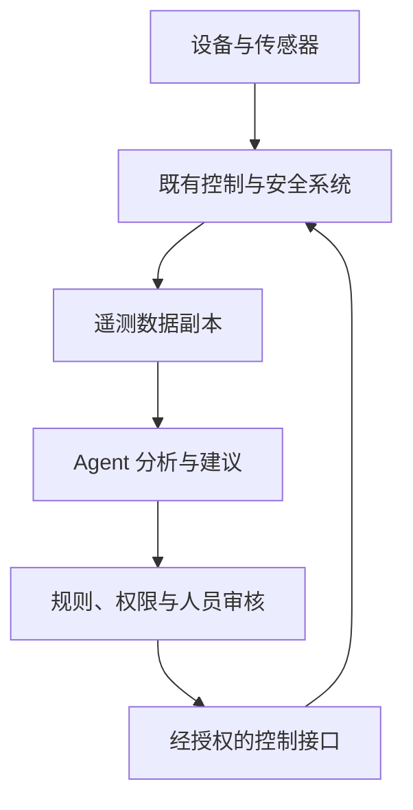

# 78. 工业 Agent 落地：七项工程检查

> **场景引入**：云端模型请求超时 5 秒，设备安全控制不能因此等待它“想明白”。实时控制与模型建议的时间要求不同。

> 对应[原始材料](../origanl/78-工业Agent落地避坑：7大铁律缺一不可.md)。工业控制属于高风险场景；具体安全完整性、时延与审批要求应由设备、工艺和适用标准决定。参考 [NIST OT 安全指南](https://csrc.nist.gov/pubs/sp/800/82/r3/final)。

---

## 🎯 一句话定位

大模型可辅助分析报警、查询手册和生成维护建议，但不能因为能调用设备接口，就让它直接接管闭环实时控制。模型的概率输出与工业控制对确定性、时延和故障安全的要求不同。设计必须把建议层与控制层隔开。

---

## 💎 核心要点概览

| 层次 | 设计原则 |
| --- | --- |
| 现场控制 | 确定性系统和安全联锁持续独立工作 |
| Agent 建议 | 使用可核实的遥测与手册版本 |
| 写入审批 | 参数范围、权限和高风险确认 |
| 故障恢复 | 超时、断网和传感异常进入预设状态 |

---

## 🚀 核心总结

> **先定义安全边界和失效状态，再让 Agent 参与辅助分析。**

---

## 一、七项工程检查

1. **边界**：明确 Agent 可读哪些遥测、可建议哪些动作，禁止越过控制系统与安全联锁。
2. **实时性**：需要毫秒级确定响应的逻辑留在本地控制系统；云端模型不能承担硬实时闭环。
3. **故障安全**：网络中断、模型不可用、数据异常时回到已验证的运行模式。
4. **执行确认**：下发动作后读取设备反馈，区分已接受、已执行与达到工艺目标。
5. **数据质量**：校验时间戳、单位、传感器健康度和数据缺失，避免脏数据驱动错误建议。
6. **权限与审核**：按设备、操作类型和人员角色授权；高影响动作由独立规则与人工审批。
7. **追溯与演练**：记录输入、模型版本、建议、审批和设备反馈，并用仿真或隔离环境演练异常。

原稿说工业系统必须“绝对安全、绝对可靠”并给出一刀切的毫秒要求，不符合工程实际。应通过危害分析确定风险等级，再建立可验证的控制与应急措施。RAG 引用手册也不等于建议自动安全。

**面试口述：**“工业 Agent 放在辅助分析层，实时控制和安全联锁保留在确定性系统。先做危害分析，再定义读写边界、故障降级、审批和可追溯验证。”

**自检：**云端模型超时 5 秒，设备安全逻辑是否应等待它的回答？

---

## 二、生产环境 Checklist

- [ ] 危害分析与设备适用标准已完成。
- [ ] 模型无权绕过安全联锁或实时控制。
- [ ] 参数与规程版本经过执行层校验。
- [ ] 断网、超时和异常反馈有独立安全路径。

## 三、总结（一句话带走）

> **工业 Agent 可以给建议，安全控制必须独立、可验证。**
